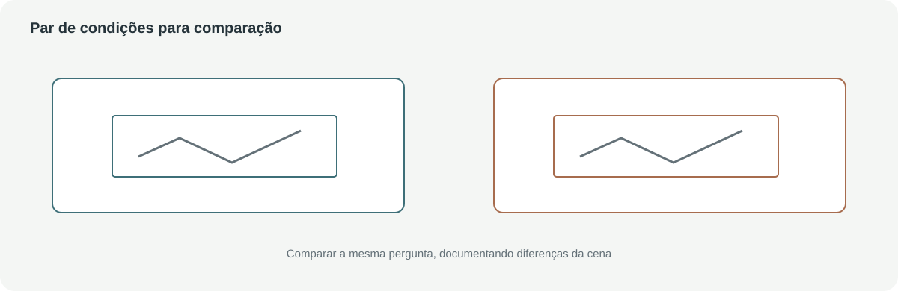
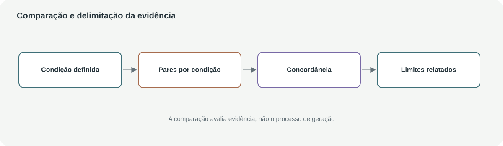
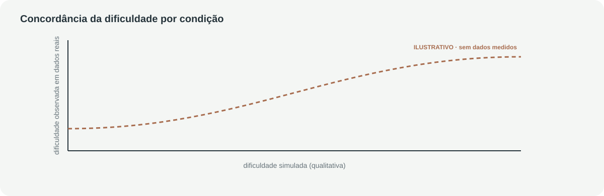

# Simulação como complemento da avaliação de desenhos capturados

## Resumo

Gravar de forma sistemática condições variadas para avaliar um sistema de desenho assistido por câmera pode exigir tempo, organização de sessões e acesso a materiais e contextos específicos. Cenas sintéticas permitem construir situações controladas e repetíveis, mas não são automaticamente equivalentes a capturas reais. Este artigo propõe um quadro para determinar o que uma simulação pode representar, o que não deve sustentar sozinha e quais alegações exigem evidência real. A proposta distingue geometria e arranjos controláveis, aparência e comportamento dependentes do contexto e efeitos de captura cuja validade precisa ser conferida com observações reais. O protocolo pareia condições simuladas e reais pela pergunta de avaliação, mede concordância na ordenação de dificuldade e descreve a diferença entre domínios. Também prevê registrar cobertura, incerteza e casos sem par comparável. Figuras esquemáticas apresentam o par de condições, o fluxo de validação e uma forma ilustrativa de concordância. Como não há dados medidos, o artigo não afirma que cenas sintéticas representem o uso cotidiano nem que substituam captura real. A contribuição é um critério de interpretação para complementar, e não substituir, evidência empírica real.

**Palavras-chave:** simulação; dados sintéticos; validade; avaliação; desenho

## Abstract

Systematically recording varied conditions to evaluate a camera-assisted drawing system can require time, session organization, and access to specific materials and contexts. Synthetic scenes can create controlled and repeatable situations, but they are not automatically equivalent to real captures. This article proposes a framework for determining what a simulation can represent, what it cannot support on its own, and which claims require real evidence. The proposal distinguishes controllable geometry and layouts, appearance and behavior that depend on context, and capture effects whose validity must be checked against real observations. The protocol pairs simulated and real conditions by evaluation question, measures agreement in difficulty ordering, and describes the gap between domains. It also provides for reporting coverage, uncertainty, and cases without a comparable pair. Schematic figures show the condition pair, validation flow, and an illustrative form of agreement. Since no measured data are available, the article does not claim that synthetic scenes represent everyday use or replace real capture. Its contribution is an interpretation criterion for complementing, not replacing, real empirical evidence.

**Keywords:** simulation; synthetic data; validity; evaluation; drawing

## 1. Introdução

Gravar de forma sistemática condições variadas para avaliar desenho capturado por câmera pode ser caro em tempo e coordenação. Uma equipe precisa planejar tarefas, registrar materiais, obter consentimento quando há participantes e repetir cenas para separar variação ambiental de mudança na atividade. Certas condições, como trocas de página ou combinações específicas de iluminação, podem ocorrer raramente em uso natural. A simulação oferece uma forma de cobrir situações controladas, mas sua conveniência não garante que a aparência ou a dificuldade correspondam ao mundo real.

O problema central é de validade. Uma cena sintética pode preservar uma propriedade relevante e, ao mesmo tempo, omitir outras. Uma composição pode representar posição e tamanho de uma folha, mas não reproduzir fielmente textura do papel, reflexo, sombra, comportamento da mão ou ruído de captura. Mesmo quando uma dimensão visual parece semelhante, a resposta observada em um sistema pode divergir. A utilidade da simulação precisa ser estabelecida para uma pergunta, uma condição e um desfecho determinados.

Este artigo propõe examinar simulação como complemento da avaliação real de um sistema de desenho assistido por câmera, tratado como caixa-preta. A pergunta é: **em que condições uma comparação entre cenas simuladas e capturas reais sustenta conclusões sobre a dificuldade relativa de avaliação, e quais aspectos continuam exigindo evidência real?** A formulação não supõe que a ordem de dificuldade se mantenha. Essa concordância é algo a medir, e qualquer conclusão se limita às condições pareadas e observadas.

O artigo oferece três contribuições. Primeiro, organiza um quadro de cobertura que separa aspectos que podem ser representados, aspectos que a simulação não deve afirmar e alegações que dependem de observação real. Segundo, especifica um protocolo com pares de condições real e simulada e medidas de concordância, diferença e cobertura. Terceiro, delimita como relatar discrepâncias e evitar extrapolação entre domínios. A proposta não apresenta um gerador, uma coleção sintética ou resultados de transferência.

A seção 2 revisa dados sintéticos em visão computacional, transferência entre domínios e validade de simulações para avaliação. A seção 3 define a cobertura e separa geometria, aparência, comportamento e captura. A seção 4 descreve pareamento, dados, métricas e análise. A seção 5 reserva campos para resultados futuros. A seção 6 discute possíveis padrões de concordância ou divergência. A seção 7 apresenta ameaças à validade, e a seção 8 resume a evidência necessária.

A motivação econômica não deve ser confundida com substituição metodológica. Uma simulação pode reduzir custo de preparação de casos ou permitir repetição sob uma condição definida. Ainda assim, os recursos economizados não demonstram que os casos cubram fenômenos importantes. O estudo precisa considerar o custo de validar os pares reais, de revisar categorias e de atualizar conclusões quando a simulação não se alinha ao uso observado. Esse esforço faz parte da validade da proposta.

O estudo define com antecedência qual propriedade deve permanecer comparável entre os domínios. A condição pode se referir a posição da página, presença de sombra, deformação ou outra característica relevante para a pergunta. Não basta comparar imagens pelo aspecto geral. A anotação deve indicar qual condição está presente, como ela foi observada e qual resultado externo será medido. Se uma simulação contiver várias diferenças sem correspondência real, ela pode ser útil para exploração, mas não para sustentar uma comparação pareada.

Dados sintéticos e capturas reais também podem desempenhar papéis complementares. Cenas sintéticas podem ampliar uma grade de condições, explorar combinações raras ou apoiar uma análise de casos-limite. As capturas reais podem verificar se essas situações ocorrem e se a resposta observada acompanha a tendência simulada. O protocolo exige distinguir descoberta exploratória de validação. Uma hipótese identificada em cenas sintéticas só se torna evidência sobre o uso real após ser testada em capturas reais adequadas.

## 2. Trabalhos relacionados

### 2.1 Dados sintéticos em visão computacional

Dados sintéticos são usados em visão computacional para ampliar coleções, controlar fatores de cena e oferecer rótulos associados a situações construídas. Ambientes virtuais e imagens renderizadas permitem repetir condições que seriam difíceis de registrar com precisão em campo. A literatura mostra aplicações em reconhecimento, segmentação, estimativa de movimento e percepção de cenas. Essa experiência fornece estratégias para definir uma condição e construir pares comparáveis, mas não prova que a distribuição sintética corresponda à de fotografias reais. Tipo de conteúdo, aparência e tarefa afetam a transferibilidade.

Benchmarks sintéticos costumam priorizar cobertura de categorias e consistência de anotação. Eles podem expor casos raros e sustentar comparações controladas, porém também incorporam escolhas de construção que delimitam o que está representado. Um conjunto pode variar posição, escala ou oclusão e deixar de fora textura, iluminação complexa ou comportamento humano. A descrição de cobertura precisa explicitar essas escolhas. Para desenho em papel, a semelhança visual de uma composição não basta para representar as propriedades do suporte ou da interação.

Estudos de simulação também usam dados sintéticos para desenvolvimento e testes em domínios onde observação real é escassa ou dispendiosa. A avaliação mais convincente compara resultados em condições reais independentes e informa quais aspectos foram preservados. Sem essa verificação, a simulação demonstra que um caso foi produzido, não que ele representa uma condição de uso. Esse princípio orienta o quadro de cobertura deste artigo. Conjuntos construídos para percepção urbana, rastreamento e cenas internas mostram a diversidade de tarefas que adotam cenários virtuais [6–10, 13, 19, 24, 25]. Eles ilustram controle e escala, mas não validam a representação de desenho em papel.

Alguns trabalhos usam jogos ou mundos virtuais para obter rótulos e cobrir situações raras; outros comparam dados sintéticos com capturas de campo. O desenho de um benchmark determina quais fatores variam e quais permanecem fixos. A diversidade de categorias não equivale à diversidade de materiais, câmeras ou pessoas. Essa distinção é importante para evitar que uma grande coleção de variações correlacionadas seja tratada como representação ampla do uso real. O presente artigo considera a unidade relevante como a condição e seu par observado, e não a quantidade de imagens por si só.

### 2.2 Transferência entre domínios

A transferência entre domínios examina se uma relação observada em uma distribuição se mantém em outra. Diferenças podem envolver cor, textura, iluminação, fundo, resolução ou composição. Pesquisas de adaptação e randomização de domínio investigam maneiras de reduzir dependência de aparências específicas. Seus resultados variam de acordo com tarefa, dados e avaliação. Portanto, uma técnica que transfere para um benchmark de objetos não garante equivalência para papel, tinta ou desenho capturado em ambiente cotidiano.

O intervalo entre simulação e realidade, frequentemente chamado de sim-to-real, pode aparecer como diferença de aparência ou de comportamento do sistema. A primeira pode ser julgada por observadores ou medidas visuais; a segunda exige avaliar saídas na tarefa relevante. Uma imagem sintética pode parecer plausível e ainda produzir uma ordenação de dificuldade diferente. O protocolo deste artigo trata a concordância de resultados como hipótese empírica, não como consequência da qualidade aparente.

A randomização de domínio procura expor uma avaliação a uma variedade de aparências simuladas [1–5, 14–18]. Ela pode ajudar a explorar sensibilidade, mas não elimina a necessidade de selecionar variações relevantes nem de verificar correspondência com dados reais. Uma variação ampla pode incluir condições improváveis e deixar de fora fenômenos frequentes. Por isso, a escolha das dimensões e dos níveis deve ser justificada por pergunta de pesquisa e evidência observacional.

Benchmarks de transferência simulada para real, avaliações de mundos virtuais e estudos de adaptação avaliam objetivos diferentes. Alguns perguntam se um modelo treinado em um domínio mantém desempenho em outro; outros perguntam se uma condição simulada reproduz dificuldade ou comportamento de uma tarefa real [11, 12, 20, 21, 26]. A segunda pergunta é central neste artigo. Um resultado de transferência para controle robótico ou classificação de peças não sustenta, por analogia, validade de dados para desenho. A unidade de evidência deve coincidir com a alegação pretendida.

### 2.3 Validade de simulações para avaliação

Validade de simulação depende do uso que se pretende fazer dela. Uma simulação pode ser válida para comparar opções em uma geometria controlada e inválida para estimar desempenho em uso natural. A afirmação sustentada deve acompanhar a granularidade da comparação: mesma pergunta, condição pareada, métrica correspondente e domínio declarado. Métricas de concordância entre condições podem indicar se a ordem relativa se mantém, enquanto diferenças absolutas revelam que as saídas não são intercambiáveis.

Um desenho de avaliação precisa evitar a seleção retrospectiva dos pares que concordam. As condições pareadas, desfechos, critérios de inclusão e análise são definidos antes de observar as diferenças. Casos sem par correspondente são reportados como lacuna de cobertura. As observações reais devem ser independentes do processo que construiu a simulação, caso contrário uma semelhança artificial pode refletir apenas a escolha de avaliação.

A lacuna abordada é a falta de um quadro de interpretação voltado à avaliação de desenho capturado por câmera que diga, fator por fator, o que uma cena sintética permite testar e o que continua dependendo de captura real. Revisões de métodos de geração e estudos de transferência reforçam que finalidade e domínio importam [22, 23]. Trabalhos de sim-to-real e dados sintéticos oferecem precedentes, mas a validade varia com a tarefa. Este artigo propõe tornar explícita essa fronteira e medir concordância por condição, sem presumir equivalência entre domínios.

Um conjunto de documentos sintéticos mostra que o próprio tipo de objeto pode ser mais próximo do problema, porém ainda precisa ser validado para a pergunta presente. Documentos históricos, textos impressos ou páginas anotadas não equivalem a desenhos que mudam durante uma sessão. O tipo de marca, a referência e o desfecho diferem. Estudos de síntese para documentos e análises de jogos como fonte visual oferecem precedentes metodológicos, não evidência direta sobre identidade, continuidade ou preservação de desenhos [24, 25].

## 3. Enquadramento do problema

O escopo da simulação é definido pela propriedade visual ou pela condição que a pergunta exige observar. Ela pode ajudar a representar posições relativas, ocupação aproximada da página, presença de objetos e algumas variações controladas de aparência. Essa capacidade não implica que detalhes visuais correspondam a materiais reais. A fronteira é específica para cada afirmação: representar uma folha inclinada não demonstra fidelidade de textura, iluminação ou resposta em uma tarefa.

O quadro de cobertura distingue três categorias. **Pode representar** indica um atributo que pode ser incluído como condição abstrata e comparado com uma pergunta correspondente. **Não deve representar sem validação** indica fenômenos cuja aparência ou comportamento não pode ser assumido como equivalente apenas porque um esquema visual foi construído. **Exige evidência real** identifica uma alegação que precisa ser examinada em captura de uso ou referência independente. A tabela é uma ferramenta de planejamento, não uma auditoria de qualquer conjunto existente.

**Tabela 1.** Quadro de cobertura que separa atributos representáveis, fenômenos que não podem ser presumidos equivalentes e alegações que exigem comparação com capturas reais independentes para determinar sua validade.

| Aspecto | Pode representar | Não pode sustentar sozinho | Exige evidência real |
|---|---|---|---|
| Geometria da página | Posição, orientação e tamanho relativos | Fidelidade de toda a deformação física | Correspondência com folhas capturadas |
| Layout do desenho | Distribuição esquemática de traços e regiões | Variedade de estilos e marcas espontâneas | Preservação de desenhos reais |
| Oclusão | Área ou região abstrata coberta | Movimento natural de mãos e instrumentos | Sequências de uso com participantes |
| Iluminação | Condições qualitativas planejadas | Reflexos e sombras de materiais diversos | Resposta em cenas reais de iluminação |
| Papel | Categorias visuais gerais de superfície | Textura e propriedades ópticas completas | Diversidade de papéis e tintas observadas |
| Fundo | Presença e contraste geral ao redor | Frequência de objetos em ambientes cotidianos | Amostra natural de espaços e superfícies |
| Captura | Perguntas sobre resposta em uma condição definida | Distribuição de artefatos de diferentes aparelhos | Comparação externa em gravações reais |
| Interação | Casos conceituais de entrada e saída | Variação humana, intenção e estratégia de desenho | Sessões reais e observação de tarefa |

O quadro distingue fidelidade visual de validade funcional. Duas cenas podem parecer parecidas para um observador e ainda produzir respostas diferentes. Também podem parecer diferentes e gerar a mesma dificuldade para uma tarefa. A avaliação não compara apenas aparência global: define o evento, o desfecho e a decisão que se deseja testar. Se a pergunta for continuidade de página, o par deve representar a mesma classe de evento e uma referência comum. Se a pergunta for preservação de traço, a referência precisa tornar a comparação do desenho possível.

A noção de “não pode representar” é provisória e contextual. Uma simulação pode incluir textura ou variação de luz, mas sua existência não prova que a distribuição reproduza materiais reais. A tabela usa “não pode sustentar sozinha” para enfatizar que tais fatores podem ser incluídos como hipótese, desde que avaliados contra capturas. A categoria não proíbe seu uso; delimita a força da afirmação sem validação.

O quadro não classifica toda a cena como válida ou inválida. Cada linha indica uma propriedade e o tipo de conclusão que ela pode apoiar. Uma avaliação pode usar simulação para comparar posições de página e ainda exigir captura real para analisar o efeito de papel brilhante. A delimitação evita o falso dilema entre aceitar ou rejeitar a simulação inteira. Ela permite que uma parte controlada seja útil e que outras partes permaneçam em aberto.

Uma condição sintética pode ser útil mesmo que não reproduza uma cena completa. Ela pode isolar um evento, ajudar a explorar um caso de borda ou mostrar como uma medida se comporta sob uma alteração controlada. O valor exploratório é distinto de validade externa. O relatório identifica qual parte do estudo é exploratória e qual pretende dizer algo sobre o uso real. Um caso construído sem par real pode sugerir perguntas, mas não integra a comparação pareada.

A Figura 1 ilustra uma condição real e outra simulada associadas à mesma pergunta. Os desenhos no esquema são símbolos neutros, não representam captura ou equivalência. A correspondência é definida por atributo e tarefa, não pela aparência da figura. A legenda deixa explícito que nenhum dos quadros constitui evidência experimental.

**Figura 1.** Esquema de um par de condição real e simulada para a mesma pergunta de avaliação. Os exemplos são diagramas, não capturas ou evidências de equivalência; elaboração própria.

## 4. Protocolo de avaliação proposto

O protocolo começa com uma pergunta de avaliação e um desfecho externo definido antes da comparação. Para cada condição sintética selecionada, identifica-se uma condição real que represente a mesma propriedade relevante. Os pares são determinados por anotação da condição e não pela semelhança dos resultados. Quando não houver uma condição real adequada, o caso é mantido fora da estimativa de concordância e listado como falta de cobertura.

A coleta real é independente e documenta tarefa, suporte, ambiente, participação humana e referências usadas para avaliar a resposta. A cena simulada é descrita apenas pelo atributo que pretende representar e pela regra de pareamento adotada no estudo; este artigo não especifica como construí-la. A mesma tarefa e o mesmo critério de saída são aplicados em ambos os domínios sempre que isso for possível. Se uma medida não for comparável, a diferença é declarada em vez de forçar um pareamento.

O desenho contém uma fase de comparação por condição e outra de análise de cobertura. A primeira verifica se a ordem relativa de dificuldade observada em condições sintéticas acompanha a ordem obtida em pares reais. A segunda descreve quais condições tinham par, quais não tinham e quais diferiam em propriedades relevantes. Uma avaliação pode combinar condições sintéticas e reais em sessões separadas; a ordem é alternada quando isso reduz efeitos de sequência. As unidades de amostragem e as repetições são definidas pela pergunta e justificadas antes da coleta.

**Tabela 2.** Métricas para concordância de ordenação, diferença por condição e cobertura do conjunto, com interpretação e limites definidos antes da coleta e sem presumir equivalência entre domínios.

| Métrica | Definição | Uso | Limitação |
|---|---|---|---|
| Concordância de ordem | Associação entre ordenações por condição sintética e real | Avalia manutenção da dificuldade relativa | Não informa igualdade de desempenho |
| Diferença pareada | Distância entre respostas para cada condição correspondente | Descreve divergência entre domínios | Depende da escala e da métrica externa |
| Concordância por condição | Proporção de pares com ordenação compatível | Localiza condições discordantes | Depende da regra de empate |
| Cobertura pareada | Condições planejadas com par real válido | Delimita o alcance da comparação | Não mede qualidade de um par isoladamente |
| Incerteza | Variação amostral das métricas por condição | Qualifica estabilidade das estimativas | Requer amostra e agrupamento apropriados |

Para a ordem relativa, pode-se usar correlação de postos entre as dificuldades agregadas de cada condição. A correlação é calculada sobre pares definidos previamente e acompanhada por intervalo de incerteza. Ela responde se as condições tendem a manter ordem, não se os valores ou saídas são iguais. Uma concordância elevada pode coexistir com diferença sistemática entre domínios. Por isso, a diferença pareada é relatada junto à correlação.

A diferença pareada é calculada para cada condição correspondente, com sinal e escala da medida explicitados. Se a métrica for categórica, uma tabela de concordância pode ser mais adequada que uma distância contínua. A análise não converte métricas incomparáveis em um escore composto sem justificativa. A cobertura informa quantas das condições planejadas encontraram correspondência real, e uma tabela de casos faltantes esclarece qual dimensão não pôde ser validada.

A análise estima concordância por condição, tarefa e grupo de material quando a amostra permitir. Resultados são agrupados por sessão ou participante nas capturas reais; cenas sintéticas repetidas não aumentam artificialmente o número de unidades humanas. A equipe evita tratar muitas variações da mesma cena como evidências independentes. Incerteza é apresentada para cada estimativa e a interpretação descreve desigualdades da amostra.

Uma etapa piloto verifica se cada par corresponde de fato à mesma pergunta e se as instruções de anotação permitem classificar a condição sem conhecer a saída. O piloto serve para corrigir a descrição da condição, a referência e o formulário de registro; não entra automaticamente na análise confirmatória. Alterações feitas após o piloto são relatadas. Se a definição de um par mudar depois de observar sua concordância, a análise correspondente é marcada como exploratória para evitar escolha seletiva.

As capturas reais e sintéticas devem ser processadas segundo uma regra de comparação comum, definida apenas em termos de eventos e saídas observáveis. A equipe verifica se enquadramento, tarefa ou qualidade da referência tornam um domínio mais fácil de avaliar que outro. Diferenças de visibilidade da anotação também são registradas. Quando a saída não puder ser comparada pela mesma métrica, o par continua informativo de forma descritiva, mas não contribui para uma correlação numérica.

O protocolo evita seleção retrospectiva. Pares, desfechos, exclusões e análises principais são definidos antes de comparar as saídas. Uma condição real sem par, uma simulação que represente mais de um fator ou uma referência de baixa confiança é identificada explicitamente. Análises exploratórias podem sugerir novos pares, mas são separadas das comparações pré-especificadas. A equipe registra a razão para cada exclusão e não remove divergências por parecerem improváveis.

A estabilidade da conclusão é avaliada por análise de sensibilidade quando houver alternativas justificadas para a anotação ou o pareamento. Por exemplo, uma categoria ambígua pode ser relatada sob mais de uma classificação definida previamente. Esse exame não escolhe a versão que maximiza concordância; ele mostra como a incerteza de referência afeta a estimativa. A equipe também informa se os resultados mudam quando uma sessão ou cena é omitida, respeitando a unidade de amostragem.

A Figura 2 organiza os blocos conceituais: definir a condição, estabelecer pares, avaliar concordância e delimitar o alcance da evidência. A Figura 3 mostra uma forma ilustrativa para a relação entre dificuldades sintética e real. Elas não descrevem um processo de geração nem apresentam estimativas. A validação é sobre correspondência de perguntas e resultados observáveis entre domínios.

**Figura 2.** Fluxo conceitual de especificação da condição, comparação entre pares e delimitação da evidência. O esquema não descreve como cenas simuladas são geradas na avaliação; elaboração própria.

**Figura 3.** Curva ilustrativa de associação entre dificuldade simulada e real, sem números nos eixos. A forma esperada, não é resultado; esquema sem observações ou pontos medidos; elaboração própria.

## 5. Estrutura dos resultados

Esta seção reserva o formato de relato para uma comparação futura. Não há dados experimentais apresentados neste artigo; portanto, nenhum valor de concordância, diferença ou cobertura é informado. Os campos `[PENDENTE-DADOS]` indicam resultados que só poderão ser preenchidos depois da coleta real e sintética, da revisão dos pares e da análise definida. A tabela descreve a estrutura de apresentação, sem indicar tendência esperada.

O primeiro resumo documenta quais condições foram planejadas, quais receberam um par real válido e quais ficaram sem correspondência. Para cada par, o relatório identifica a propriedade comparada, a tarefa, a referência, o desfecho e a razão para considerar as cenas comparáveis. Condições excluídas permanecem visíveis. O quadro de cobertura distingue ausência de dados de ausência de efeito e registra limitações de anotação.

**Tabela 3.** Estrutura para relatar pares de condições e medidas futuras de concordância, mantendo campos vazios até que dados reais e simulados tenham sido coletados e revisados.

| Condição | Par real válido | Concordância | Diferença e incerteza |
|---|---|---|---|
| Geometria e layout | [PENDENTE-DADOS] | [PENDENTE-DADOS] | [PENDENTE-DADOS] |
| Aparência e iluminação | [PENDENTE-DADOS] | [PENDENTE-DADOS] | [PENDENTE-DADOS] |
| Oclusão e interação | [PENDENTE-DADOS] | [PENDENTE-DADOS] | [PENDENTE-DADOS] |
| Condição sem par comparável | Não aplicável | Não aplicável | [PENDENTE-DADOS] |

Os resultados devem apresentar ordenação de dificuldade por condição nos dois domínios, junto da concordância e da diferença pareada. A cobertura indica que parte das condições planejadas foi validada. As condições sem par não entram no cálculo da concordância, mas aparecem na descrição. Se as distribuições forem muito diferentes, o relatório não as resume em uma estimativa única sem mostrar a heterogeneidade.

As figuras esquemáticas deste artigo não são gráficos de resultado. Uma figura empírica futura deverá mostrar observações e incerteza por condição, além de identificar quais pares foram usados. Se a ordem entre condições variar entre tarefas ou materiais, os grupos serão exibidos separadamente. Campos sem dados permanecem como `[PENDENTE-DADOS]` até haver evidência revisada.

## 6. Discussão

Se a ordem de dificuldade for semelhante entre as condições simuladas e reais, o resultado apoiará uma afirmação limitada: para os pares, tarefa, amostra e medida avaliados, a simulação preservou parte da ordenação relativa. Isso não demonstrará igualdade de desempenho, fidelidade universal ou cobertura do uso cotidiano. Uma concordância de ordem pode coexistir com diferença sistemática entre domínios. A interpretação deve mostrar ambos os aspectos e delimitar a amostra real que foi usada.

Se houver concordância apenas em certas condições, a conclusão será específica a esses fatores. A simulação pode ser adequada para explorar geometria e não para representar textura ou interação, por exemplo, mas essa inferência exige dados correspondentes e não pode ser deduzida da tabela conceitual. A análise por grupos ajuda a localizar a fronteira entre condições úteis e condições ainda sem validação. O relatório evita extrapolar um resultado agregado para dimensões que não participaram da comparação.

Uma discordância sistemática indica que a simulação não preservou a relação observada para a pergunta testada. A diferença pode decorrer de atributos visuais ausentes, de pareamento imperfeito ou de variabilidade das capturas reais. O protocolo não atribui causa automática; anotações e análise de sensibilidade podem orientar uma hipótese futura. A discrepância é informação relevante, não um resultado a descartar por ser inconveniente.

Uma correlação fraca ou imprecisa também pode refletir cobertura insuficiente ou poucos pares representativos. Se a incerteza for ampla, não se conclui equivalência nem incompatibilidade. A interpretação distingue falta de evidência de evidência de divergência. Condições sem dados reais permanecem fora do alcance, mesmo que a cena sintética pareça plausível.

Trabalhos de transferência entre domínios e randomização fornecem conceitos para discutir robustez a mudança de aparência. Pesquisas com ambientes virtuais mostram como controlar condições e repetir casos. Entretanto, essas contribuições não estabelecem validade automática para desenhos capturados. Este estudo concentra a pergunta em concordância de dificuldade por condição e mantém os domínios separados na análise. Evidência de uma tarefa não se transfere necessariamente a outra, sobretudo quando referência, material e comportamento de participantes mudam.

O custo de capturar dados reais pode justificar o uso de simulação para triagem e exploração. A economia, contudo, deve ser descrita junto com o custo de validação e a cobertura de condições reais. Se os pares só cobrem situações fáceis de reproduzir, a simulação pode enviesar a pesquisa para o que é simples de representar. Uma cobertura explícita mostra esse compromisso e ajuda a planejar coleta real adicional.

Também é possível que uma condição sintética revele uma dificuldade que não apareça nos pares reais disponíveis. Esse achado pode ser útil como hipótese ou teste de estresse, mas não prova risco em uso cotidiano. A resposta adequada é buscar captura real pertinente, ajustar a pergunta ou rotular a condição como exploratória. O artigo não recomenda excluir casos sintéticos divergentes, pois eles podem orientar estudos posteriores.

Uma simulação não precisa representar toda a realidade para ser útil. Uma abstração pode responder a uma pergunta estreita com controle e repetibilidade. A decisão metodológica depende do que se pretende inferir: comparação interna entre condições abstratas, transferência para captura real ou suporte a uma alegação de desempenho. Os resultados e as conclusões devem usar linguagem proporcional a esse propósito.

A validade também depende de uma referência real independente. Se a condição real for escolhida após observar o resultado sintético, a concordância pode ser inflada. Se a anotação real for ambígua, o pareamento pode refletir decisão dos pesquisadores. O plano deve fixar a seleção das condições e reportar discordâncias entre anotadores. Esse cuidado torna a comparação mais informativa, mas não elimina a incerteza do domínio.

Em suma, o protocolo trata concordância, diferença e cobertura como perguntas separadas. Concordância mostra manutenção da ordem relativa; diferença caracteriza magnitude e direção; cobertura define até onde a comparação alcança. Nenhuma medida isolada autoriza substituir capturas reais. O valor metodológico está em tornar visível a fronteira de evidência e orientar onde novos dados são necessários.

## 7. Limitações e ameaças à validade

A validade de construção depende de como uma condição real e uma sintética são consideradas pares. Se atributos importantes diferirem, a comparação pode atribuir discordância a um fator que não foi isolado. Se as definições forem vagas, avaliadores podem formar pares diferentes. O manual da condição, a revisão independente e a justificativa de pareamento devem ser documentados. A tabela de cobertura ajuda a explicitar a decisão, mas não garante que os atributos escolhidos representem a pergunta.

A validade interna pode ser afetada por mudanças simultâneas entre condições. Uma cena sintética e sua captura real podem diferir em vários aspectos além do fator de interesse. A análise pareada reduz algumas diferenças, mas não as elimina. A escolha retrospectiva de pares concordantes, exclusão de divergências ou ajuste da tarefa após observar resultados pode introduzir viés. Pré-especificação, registro de exclusões e separação entre análises confirmatórias e exploratórias reduzem esse risco.

A validade externa é limitada pela variedade de condições reais. Uma coleção capturada em um ambiente ou com um tipo de papel não representa todo uso. A simulação pode ampliar a cobertura abstrata, mas não aumenta a diversidade real observada. Participantes, materiais, tarefa, câmera e contexto devem ser descritos de forma compatível com privacidade. Conclusões ficam restritas a esses dados até que avaliações independentes as ampliem.

A validade dos dados depende das referências e da anotação. A verdade de uma condição real pode ser incerta; a medida de desempenho pode variar entre avaliadores; e a correspondência visual pode ser subjetiva. A referência e a resposta devem ter fontes independentes quando possível. Casos sem confiança suficiente são apresentados separadamente e não contam como concordância ou discordância definida.

Há ameaça de dependência entre variações sintéticas derivadas da mesma cena. Contá-las como observações independentes pode criar falsa precisão. Da mesma forma, múltiplas capturas de uma sessão real podem compartilhar contexto. A análise deve refletir agrupamento por cena, sessão e participante e mostrar quantas unidades independentes sustentam cada estimativa. Repetição visual não equivale a diversidade amostral.

Outra limitação é a natureza provisória do quadro. Novas técnicas podem representar melhor certos fenômenos, e novos usos podem tornar outros fatores prioritários. A classificação “não pode sustentar sozinha” não é uma impossibilidade física; significa apenas que o artigo não atribui validade sem demonstração. Pesquisas futuras podem revisar o quadro quando apresentarem validação suficiente.

Por fim, o estudo avalia saídas externas do sistema e não identifica mecanismos internos. Uma divergência não diz se sua causa está na cena, no pareamento ou na resposta. Essa fronteira é necessária para preservar o escopo de avaliação e evita inferências sobre implementação. O artigo não fornece um procedimento para construir cenas sintéticas nem uma receita que reproduza qualquer sistema específico.

## 8. Conclusão

Este artigo propõe um quadro para interpretar dados sintéticos na avaliação de desenho capturado por câmera. A seção central separa propriedades que podem ser representadas, fenômenos cuja equivalência não pode ser presumida e alegações que dependem de capturas reais. O protocolo compara pares por condição, ordenação de dificuldade, diferença e cobertura, mantendo o sistema como caixa-preta.

A simulação pode apoiar controle e repetição, mas sua utilidade para uma conclusão sobre uso real precisa ser demonstrada. Uma aparência plausível não basta para estabelecer correspondência de resposta. Concordância, discordância e ausência de pares informam decisões metodológicas distintas e devem ser relatadas com incerteza.

Ainda é necessária uma avaliação que colete pares reais e sintéticos para tarefas e condições explicitamente definidas. Até que esses dados sejam analisados, a concordância e o alcance da simulação permanecem `[PENDENTE-DADOS]`. Resultados futuros devem delimitar suas conclusões à cobertura real observada e manter situações exploratórias claramente identificadas.

## Declarações

- Uso de IA: texto redigido com apoio de IA generativa, com revisão e responsabilidade dos autores; referências conferidas por DOI.
- Dados: não há dados experimentais nesta proposta; dados futuros serão descritos com sua origem e critérios de acesso.
- Código: não há código de análise de resultados nesta versão; materiais futuros serão identificados por versão.
- Conflito de interesses: os autores deverão declarar qualquer conflito pertinente antes da submissão.
- Ética: qualquer coleta com participantes será submetida à avaliação ética aplicável antes do recrutamento.
- Contribuição dos autores: a versão final deverá explicitar as contribuições individuais dos autores.

## Referências

[1] Tobin, J. et al. Domain Randomization for Transferring Deep Neural Networks from Simulation to the Real World. IEEE/RSJ International Conference on Intelligent Robots and Systems, 2017. https://doi.org/10.1109/IROS.2017.8202133
[2] Tremblay, J. et al. Training Deep Networks with Synthetic Data: Bridging the Reality Gap by Domain Randomization. IEEE/CVF Conference on Computer Vision and Pattern Recognition Workshops, 2018. https://doi.org/10.1109/CVPRW.2018.00143
[3] Peng, X. B. et al. Sim-to-Real Transfer of Robotic Control with Dynamics Randomization. IEEE International Conference on Robotics and Automation, 2018. https://doi.org/10.1109/ICRA.2018.8460528
[4] Prakash, A. et al. Structured Domain Randomization: Bridging the Reality Gap by Context-Aware Synthetic Data. IEEE International Conference on Robotics and Automation, 2019. https://doi.org/10.1109/ICRA.2019.8794443
[5] Sadeghi, F.; Levine, S. CAD2RL: Real Single-Image Flight Without a Single Real Image. Robotics: Science and Systems XIII, 2017. https://doi.org/10.15607/RSS.2017.XIII.034
[6] Ros, G. et al. The SYNTHIA Dataset: A Large Collection of Synthetic Images for Semantic Segmentation of Urban Scenes. IEEE/CVF Conference on Computer Vision and Pattern Recognition, 2016. https://doi.org/10.1109/CVPR.2016.352
[7] Richter, S. R. et al. Playing for Data: Ground Truth from Computer Games. European Conference on Computer Vision, 2016. https://doi.org/10.1007/978-3-319-46475-6_7
[8] Gaidon, A. et al. Virtual Worlds as Proxy for Multi-Object Tracking Analysis. IEEE/CVF Conference on Computer Vision and Pattern Recognition, 2016. https://doi.org/10.1109/CVPR.2016.470
[9] Cordts, M. et al. The Cityscapes Dataset for Semantic Urban Scene Understanding. IEEE/CVF Conference on Computer Vision and Pattern Recognition, 2016. https://doi.org/10.1109/CVPR.2016.350
[10] Dosovitskiy, A. et al. CARLA: An Open Urban Driving Simulator. Conference on Robot Learning, 2017. https://proceedings.mlr.press/v78/dosovitskiy17a.html
[11] Johnson-Roberson, M. et al. Driving in the Matrix: Can Virtual Worlds Replace Human-Generated Annotations for Real World Tasks? IEEE International Conference on Robotics and Automation, 2017. https://doi.org/10.1109/ICRA.2017.7989092
[12] Peng, X. et al. VisDA: A Synthetic-to-Real Benchmark for Visual Domain Adaptation. IEEE/CVF Conference on Computer Vision and Pattern Recognition Workshops, 2018. https://openaccess.thecvf.com/content_cvpr_2018_workshops/w40/html/Peng_VisDA_A_Synthetic-to-Real_CVPR_2018_paper.html
[13] Handa, A. et al. Understanding Real World Indoor Scenes With Synthetic Data. IEEE/CVF Conference on Computer Vision and Pattern Recognition, 2016. https://doi.org/10.1109/CVPR.2016.442
[14] Sankaranarayanan, S. et al. Learning From Synthetic Data: Addressing Domain Shift for Semantic Segmentation. IEEE/CVF Conference on Computer Vision and Pattern Recognition, 2018. https://openaccess.thecvf.com/content_cvpr_2018/papers/Sankaranarayanan_Learning_From_Synthetic_CVPR_2018_paper.pdf
[15] Sankaranarayanan, S. et al. Generate to Adapt: Aligning Domains Using Generative Adversarial Networks. IEEE/CVF Conference on Computer Vision and Pattern Recognition, 2018. https://openaccess.thecvf.com/content_cvpr_2018/html/Sankaranarayanan_Generate_to_Adapt_CVPR_2018_paper.html
[16] James, S. et al. Sim-To-Real via Sim-To-Sim: Data-Efficient Robotic Grasping via Randomized-To-Canonical Adaptation Networks. IEEE/CVF Conference on Computer Vision and Pattern Recognition, 2019. https://openaccess.thecvf.com/content_CVPR_2019/html/James_Sim-To-Real_via_Sim-To-Sim_Data-Efficient_Robotic_Grasping_via_Randomized-To-Canonical_Adaptation_Networks_CVPR_2019_paper.html
[17] Zhao, Y. et al. Domain Decluttering: Simplifying Images to Mitigate Synthetic-Real Domain Shift and Improve Depth Estimation. IEEE/CVF Conference on Computer Vision and Pattern Recognition, 2020. https://openaccess.thecvf.com/content_CVPR_2020/html/Zhao_Domain_Decluttering_Simplifying_Images_to_Mitigate_Synthetic-Real_Domain_Shift_and_CVPR_2020_paper.html
[18] Alghonaim, R.; Johns, E. Benchmarking Domain Randomisation for Visual Sim-to-Real Transfer. IEEE International Conference on Robotics and Automation, 2021. https://doi.org/10.1109/ICRA48506.2021.9561134
[19] Roberts, M. et al. Hypersim: A Photorealistic Synthetic Dataset for Holistic Indoor Scene Understanding. IEEE/CVF International Conference on Computer Vision, 2021. https://doi.org/10.1109/ICCV48922.2021.01073
[20] Mishra, S. et al. Task2Sim: Towards Effective Pre-Training and Transfer From Synthetic Data. IEEE/CVF Conference on Computer Vision and Pattern Recognition, 2022. https://openaccess.thecvf.com/content/CVPR2022/html/Mishra_Task2Sim_Towards_Effective_Pre-Training_and_Transfer_From_Synthetic_Data_CVPR_2022_paper.html
[21] Tang, H.; Jia, K. A New Benchmark: On the Utility of Synthetic Data With Blender for Bare Supervised Learning and Downstream Domain Adaptation. IEEE/CVF Conference on Computer Vision and Pattern Recognition, 2023. https://openaccess.thecvf.com/content/CVPR2023/html/Tang_A_New_Benchmark_On_the_Utility_of_Synthetic_Data_With_CVPR_2023_paper.html
[22] Schieber, H. et al. Indoor Synthetic Data Generation: A Systematic Review. Computer Vision and Image Understanding, 2024. https://doi.org/10.1016/j.cviu.2023.103907
[23] Paulin, G.; Ivasić-Kos, M. Review and Analysis of Synthetic Dataset Generation Methods and Techniques for Application in Computer Vision. Artificial Intelligence Review, 2023. https://doi.org/10.1007/s10462-022-10358-3
[24] Walker, D.; Lund, W.; Ringger, E. A Synthetic Document Image Dataset for Developing and Evaluating Historical Document Processing Methods. SPIE Proceedings, 2012. https://doi.org/10.1117/12.912203
[25] Shafaei, A.; Little, J.; Schmidt, M. Play and Learn: Using Video Games to Train Computer Vision Models. British Machine Vision Conference, 2016. https://doi.org/10.5244/C.30.26
[26] Zhu, X. et al. Towards Sim-to-Real Industrial Parts Classification With Synthetic Dataset. IEEE/CVF Conference on Computer Vision and Pattern Recognition Workshops, 2023. https://openaccess.thecvf.com/content/CVPR2023W/VISION/html/Zhu_Towards_Sim-to-Real_Industrial_Parts_Classification_With_Synthetic_Dataset_CVPRW_2023_paper.html
