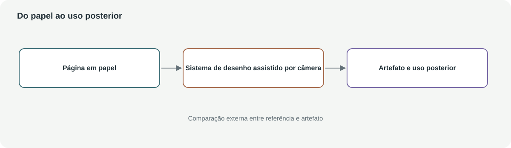
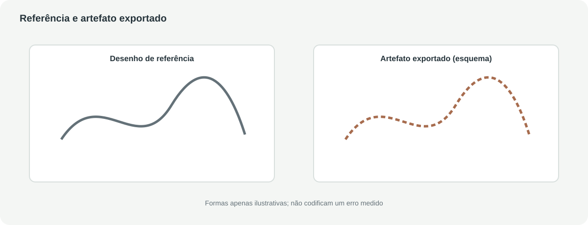
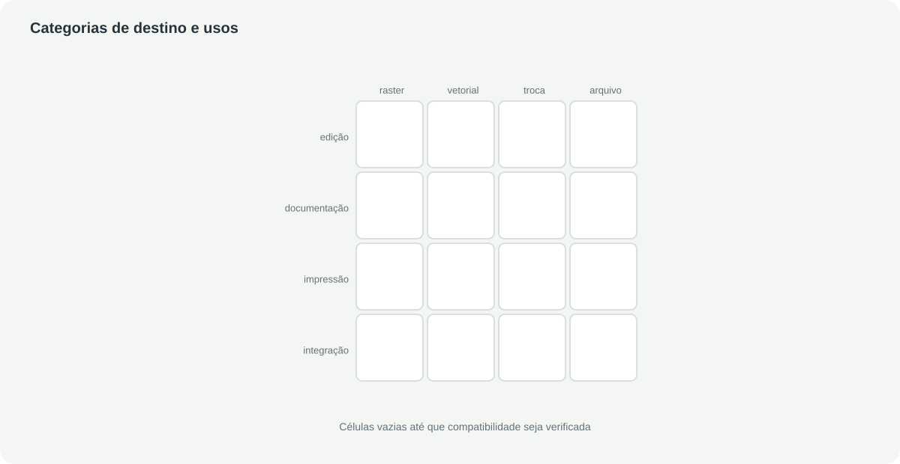

# Fidelidade geométrica na exportação de desenhos em papel

## Resumo

Converter um desenho em papel em um artefato digital pode apoiar edição, documentação, impressão e integração com outras ferramentas. A utilidade depende de quais características do desenho permanecem reconhecíveis após a exportação. “Fidelidade geométrica” não é um único aspecto: posição, escala, espessura, forma, ordem dos traços e cor podem importar de maneiras diferentes conforme o uso. Este artigo propõe uma estrutura para avaliar essas dimensões em um sistema de desenho assistido por câmera sem descrever a representação interna ou a forma de geração do arquivo. O enquadramento relaciona cada aspecto a uma necessidade posterior e a uma medida externa. O protocolo compara desenhos de referência com artefatos exportados e reimportados em categorias de ferramentas de destino, usando tolerâncias definidas para a tarefa antes da análise. Tabelas e figuras organizam aspectos, usos e compatibilidade como categorias vazias. Como não há resultados experimentais, o artigo não afirma precisão, preservação ou compatibilidade alcançada. A proposta busca tornar explícito o que será comparado, para qual uso e com que limite, evitando um critério universal de fidelidade.

**Palavras-chave:** exportação; fidelidade geométrica; desenho; interoperabilidade; avaliação

## Abstract

Converting a paper drawing into a digital artifact can support editing, documentation, printing, and integration with other tools. Its usefulness depends on which drawing characteristics remain recognizable after export. “Geometric fidelity” is not a single property: position, scale, stroke width, shape, stroke order, and color can matter differently depending on the use. This article proposes a framework for evaluating these dimensions in a camera-assisted drawing system without describing its internal representation or how the file is produced. The framework relates each aspect to a downstream need and an external measure. The protocol compares reference drawings with exported artifacts re-imported into categories of destination tools, using task-specific tolerances defined before analysis. Tables and figures organize aspects, uses, and compatibility as empty categories. Since no experimental results are available, the article makes no claim about achieved accuracy, preservation, or compatibility. The proposal makes explicit what is compared, for which use, and within what limits, avoiding a universal fidelity criterion.

**Keywords:** export; geometric fidelity; drawing; interoperability; evaluation

## 1. Introdução

Um desenho em papel pode ser útil além do momento em que foi feito. A pessoa pode querer editar a composição, guardar um registro, imprimir uma cópia ou transferir o conteúdo a outra ferramenta. A passagem para um artefato digital cria uma pergunta de avaliação: quais propriedades precisam permanecer para que o resultado sirva a cada finalidade? Uma imagem visualmente semelhante pode perder informação relevante para edição; uma representação editável pode preservar formas e ainda alterar escala ou cor na impressão.

Fidelidade geométrica costuma ser tratada como uma propriedade geral, mas reúne dimensões distintas. A posição dos elementos afeta alinhamento; a escala afeta dimensões físicas e proporções; a espessura do traço afeta leitura e aparência; a forma afeta contorno e gesto; a ordem dos traços pode importar para revisão; a cor afeta documentação e reprodução. Esses aspectos têm critérios e unidades de observação diferentes. Uma única medida global pode ocultar alterações pequenas em uma dimensão e graves em outra.

Este artigo propõe avaliar artefatos exportados por um sistema de desenho assistido por câmera, sem especificar formato interno ou método de representação. A pergunta é: **quais aspectos de posição, escala, espessura, forma, ordem e cor devem ser comparados para julgar a utilidade de uma exportação em tarefas posteriores?** A resposta depende do uso pretendido. Por isso, a proposta não escolhe um limite universal, mas exige justificar tolerâncias antes de analisar os resultados.

O artigo oferece três contribuições. Primeiro, apresenta uma taxonomia de aspectos de fidelidade e relaciona cada um a edição, documentação, impressão e integração. Segundo, define medidas externas e comparações com uma digitalização independente do original. Terceiro, propõe testes de reimportação em categorias de ferramentas e uma matriz de compatibilidade, sem afirmar que qualquer ferramenta seja suportada. As contribuições especificam como avaliar e relatar, não demonstram preservação alcançada.

A seção 2 revisa vetorização, representação de traços, interoperabilidade e preservação digital. A seção 3 define os aspectos de fidelidade e seus usos. A seção 4 descreve desenhos de referência, categorias de destino, métricas e tolerâncias. A seção 5 reserva o formato para resultados futuros. A seção 6 discute possíveis divergências entre usos. A seção 7 delimita validade e cobertura, e a seção 8 conclui indicando a evidência necessária.

A avaliação considera tanto o artefato isolado quanto seu comportamento em uma ferramenta de destino. Um arquivo pode manter uma geometria aparente quando visualizado e mudar após reimportação ou impressão. A comparação não presume que visualização, edição e preservação sejam equivalentes. O protocolo registra a categoria de uso, as condições do destino e o aspecto que está sendo testado. Se a interação com uma ferramenta alterar o resultado, essa alteração pertence ao cenário de avaliação, não é atribuída automaticamente a um formato ou componente específico.

A tolerância de comparação é uma decisão de uso. Para impressão, tamanho e escala podem ter requisitos diferentes de um rascunho digital; para documentação, cor e forma podem ser essenciais; para edição, ordem e separação lógica podem ser relevantes. A tolerância é justificada pelo objetivo, por uma referência apropriada ou por critérios de usuários. O artigo não apresenta valores sem essa base e mantém os aspectos separados para que necessidades distintas não sejam comprimidas em um único julgamento.

O tema também envolve preservação e acesso futuro. Um artefato útil hoje pode se tornar difícil de abrir ou editar em outro contexto. A avaliação geométrica não cobre sozinha durabilidade, metadados, licenciamento ou acessibilidade do arquivo, embora esses tópicos possam ser necessários em uma avaliação completa. O escopo aqui é a relação entre desenho original e características preservadas no artefato exportado, com atenção à reimportação e ao uso posterior.

A referência é um artefato de avaliação, não uma fonte perfeita por definição. O método de digitalização e as condições de iluminação podem alterar cor, bordas e escala. Quando a pergunta inclui dimensões físicas, a referência precisa conservar essa informação; quando inclui ordem, o registro precisa acompanhar a execução. A proposta exige que cada aspecto avaliado tenha fonte correspondente e que lacunas sejam declaradas.

## 2. Trabalhos relacionados

### 2.1 Vetorização e representação do traço

Vetorização converte informação visual em representações descritas por formas ou trajetórias, enquanto imagens rasterizadas organizam amostras em uma grade. A literatura sobre vetorização de linhas, desenhos e documentos discute precisão de contorno, continuidade, simplificação perceptual e preservação de características. Esses trabalhos indicam medidas possíveis, como distância entre curvas, sobreposição de regiões, diferença de largura ou preservação de ordem. Entretanto, os objetivos variam: reconhecer texto, reconstruir um mapa ou editar um esboço não exigem as mesmas propriedades.

Pesquisa sobre desenho digital também estuda trajetórias de caneta, reconstrução de traços, semelhança de esboços e formas de medir qualidade. A comparação geométrica pode usar pontos correspondentes, distância entre contornos, estrutura topológica ou avaliação perceptual. Nenhuma métrica cobre simultaneamente posição, escala, espessura, forma e ordem. A escolha depende da pergunta e da possibilidade de obter uma referência independente.

Uma dificuldade é alinhar duas representações antes de comparar. Se a página muda de orientação ou escala, um deslocamento aparente pode refletir preparação da referência, não exportação. A literatura de registro de imagens e comparação de formas ajuda a estruturar essa questão, mas os procedimentos usados devem ser declarados sem inferir mecanismos internos do sistema. Este artigo limita o relato às medidas externas escolhidas.

Trabalhos clássicos de conversão de desenho de linha discutem recuperação de contornos, junções, topologia e reconstrução geométrica. Estudos mais recentes sobre vetorização de traços e esboços ampliam o foco para redes de curvas, desenhos de espessura variável e edição interativa [1–16]. Esses trabalhos mostram que geometria é composta de propriedades, não de uma única distância. Uma métrica que compara contornos pode não avaliar a ordem dos traços; uma reconstrução de junções não mede cor. O presente artigo usa esses antecedentes para selecionar medidas externas, sem avaliar qualquer método de vetorização específico.

Avaliação de qualidade de imagem oferece medidas estruturais e perceptuais que comparam uma referência e uma versão transformada. A distância de Hausdorff enfatiza discrepâncias entre conjuntos de pontos; índices estruturais resumem diferenças de aparência em escalas distintas [17–19]. Essas métricas podem apoiar certas comparações, mas não demonstram preservação de estrutura editável ou semântica. Pesquisas sobre redes de curvas em esboços também relacionam representação geométrica a possibilidades de edição e reconstrução [20]. A seleção de medida precisa, portanto, seguir o aspecto e o uso.

### 2.2 Interoperabilidade e formatos de destino

Interoperabilidade trata da troca de conteúdo entre ferramentas e serviços. Padrões de representação gráfica e estudos de sistemas de autoria documentam que aparência, estrutura editável e semântica podem ser preservadas de modo diferente ao migrar entre aplicações. Uma imagem plana pode manter aparência sem permitir edição por traço; uma representação estruturada pode facilitar alteração e ainda depender de compatibilidade no destino. Assim, o sucesso da exportação precisa ser avaliado pela tarefa posterior, não apenas pela existência de um arquivo.

Testes de conformidade e compatibilidade costumam observar leitura, escrita, renderização e troca de atributos. Para desenhos, o conjunto relevante inclui forma, cor, sequência e dimensões físicas. Uma ferramenta pode abrir o artefato e ainda modificar uma propriedade ou ignorar outra. A avaliação registra o resultado efetivamente observado após reimportação e não presume que um nome de categoria garanta compatibilidade.

Categorias como raster, vetor, troca estruturada e arquivo de preservação ajudam a planejar uma matriz sem depender de um formato específico. Elas descrevem usos e expectativas gerais; não identificam a codificação interna do artefato. Os critérios devem ser escolhidos por classe de ferramenta e tarefa, mantendo documentadas as versões e configurações externas quando necessárias à reprodução.

Especificações abertas e testes de intercâmbio ajudam a documentar quais atributos podem ser representados e como uma aplicação deve interpretá-los. A existência de uma especificação não garante que todo destino a implemente da mesma forma. Avaliar reimportação em outra ferramenta verifica compatibilidade efetiva para a combinação escolhida, sem inferir suporte universal. A categorização de destinos neste artigo evita depender de nomes específicos e concentra-se em tarefas de leitura, edição e reprodução [22, 23].

### 2.3 Preservação e usos posteriores

Preservação digital envolve manter conteúdo acessível, interpretável e utilizável ao longo do tempo. A literatura de arquivamento distingue preservar a aparência visual, preservar a estrutura editável e manter informação contextual. Essas metas podem divergir. Uma cópia de referência pode documentar o desenho, enquanto um artefato vetorial pode favorecer edição. A avaliação do presente artigo focaliza geometria, mas reconhece que durabilidade e metadados são dimensões adicionais.

Estudos de qualidade de imagem e reprodução gráfica mostram que requisitos de cor, escala e contorno variam conforme visualização, impressão e documentação. A tarefa posterior define qual divergência é aceitável. Uma tolerância útil para editar um rascunho pode não ser suficiente para reproduzir uma peça em tamanho definido. A validação precisa incluir o meio de destino e registrar como a referência foi digitalizada.

A lacuna é um protocolo que conecte aspectos geométricos a usos posteriores e teste a exportação mediante comparação externa e reimportação. A literatura oferece métodos para avaliar formas, padrões de troca e preservação, mas não um critério universal para desenho capturado em papel. Este artigo organiza essas dimensões sem afirmar compatibilidade ampla ou fidelidade já demonstrada.

Relatórios sobre propriedades significativas de imagens vetoriais ajudam a explicitar quais características merecem ser preservadas. Vocabulários de metadados e recomendações institucionais de preservação também distinguem conteúdo, representação e acesso futuro [21, 24, 25]. Esses materiais não são todos artigos experimentais; servem como fontes técnicas para o quadro de usos. A preservação de longo prazo é mais ampla que fidelidade geométrica, mas influencia quais medidas precisam continuar interpretáveis quando o arquivo é consultado em outra ferramenta ou período.

**Limites de transferência das métricas.**

Métricas desenvolvidas para imagens naturais ou desenhos técnicos podem não representar a experiência de editar um esboço. Um erro médio pode ignorar um cruzamento que muda a leitura, enquanto uma medida perceptual pode tolerar deslocamento que afeta alinhamento. A literatura fornece instrumentos que precisam ser validados para o conteúdo e a tarefa. A lacuna aqui não é inventar uma métrica universal, mas conectar dimensões independentes com usos e referências, declarando onde uma comparação não é suficiente.

## 3. Enquadramento do problema

Fidelidade é definida pela relação entre um desenho de referência e o artefato que se deseja usar depois. O conceito separa seis aspectos. **Posição** descreve a localização relativa de marcas e elementos na página. **Escala** trata da proporção entre elementos e das dimensões do desenho no meio de destino. **Espessura** descreve a largura aparente dos traços. **Forma** abrange contornos, curvas, junções e terminações. **Ordem** registra a sequência relativa em que os traços foram produzidos, quando essa informação estiver disponível na referência. **Cor** descreve tonalidade e contraste das marcas em relação ao papel.

Cada aspecto apoia usos diferentes. Edição pode exigir formas selecionáveis e ordem preservada; documentação pode priorizar posição, aparência e cor; impressão pode depender de escala, espessura e proporções físicas; integração pode exigir que elementos continuem distinguíveis em outra ferramenta. Uma tarefa pode combinar usos, mas os critérios devem ser registrados separadamente. A tabela relaciona aspecto, aplicação e medida externa, sem supor que um escore único determine a utilidade.

**Tabela 1.** Relação entre aspectos de fidelidade geométrica, usos posteriores e medidas externas, sem presumir que uma única medida atenda a todos os contextos de edição, documentação, impressão e integração.

| Aspecto | Usos relevantes | Medida externa proposta |
|---|---|---|
| Posição | Edição, documentação, alinhamento | Deslocamento relativo a pontos de referência na página |
| Escala | Impressão, composição, integração | Razão entre dimensões correspondentes e proporções globais |
| Espessura | Leitura, impressão, edição | Diferença de largura ao longo de segmentos comparáveis |
| Forma | Edição, documentação | Distância entre contornos e preservação de junções |
| Ordem dos traços | Edição, revisão da atividade | Comparação da sequência registrada com anotação independente |
| Cor | Documentação, reprodução | Diferença de cor sob condição de visualização declarada |

Posição deve ser medida em relação a uma referência estável, como a borda da página ou pontos do desenho selecionados antes da comparação. Essa medida não confunde um deslocamento global da folha com uma mudança em uma parte do traço. Escala é examinada de forma relativa e, quando o uso exige dimensões físicas, em relação ao tamanho pretendido. Uma imagem reescalada pode parecer igual na tela e divergir em impressão; o meio de uso faz parte da avaliação.

Espessura e forma são relacionadas, mas não idênticas. Um traço pode conservar o caminho central e mudar largura; outro pode manter espessura média e alterar curvas ou terminações. As medidas devem permitir observar ambos. A análise de contorno pode ser sensível à digitalização de referência, enquanto a largura pode variar ao longo do mesmo gesto. O manual define como escolher segmentos comparáveis e apresenta incerteza de anotação.

A ordem dos traços só é avaliada se houver uma fonte de referência capaz de estabelecê-la. Uma imagem estática do desenho final pode confirmar forma e posição, mas não a sequência temporal. Nesse caso, ordem é reportada como não avaliável, em vez de inferida pela aparência. A cor também depende de iluminação, digitalização e tela; a equipe registra a condição de referência e evita interpretar diferenças de visualização como alteração de exportação sem controle.

O artefato pode ser considerado geometricamente fiel para um uso e inadequado para outro. Uma alteração de cor pode ser tolerável em um rascunho de edição e inaceitável em documentação colorimétrica. Um pequeno desvio de escala pode ser irrelevante em uma miniatura e importante na impressão. Por isso, a equipe define tarefas representativas e justifica critérios com requisitos de uso, normas aplicáveis ou avaliação de usuários. A proposta não escolhe valores universais.

A interpretação de cada aspecto deve considerar a unidade de comparação. Posição pode ser global ou local; forma pode considerar um traço ou o conjunto; cor pode descrever valor médio ou variação ao longo da marca. A equipe define essa unidade com antecedência. Se um desenho contiver vários tipos de traço, sumarizar por média pode esconder um subconjunto alterado. Distribuições por desenho e por aspecto dão mais contexto que uma classificação geral.

A tolerância de uso não é inferida da variabilidade da referência sozinha. Uma medida pode ser precisa e ainda não refletir o requisito de uma pessoa que edita ou imprime. Requisitos formais, tarefa de destino e avaliação com usuários podem orientar a escolha. Se nenhum requisito estiver disponível, o artigo recomenda reportar divergência e evitar um rótulo binário de fidelidade.

A Figura 1 mostra o percurso externo entre página, sistema e uso do arquivo. A Figura 2 compara referência e exportação por meio de traços esquemáticos, sem afirmar que a forma represente um resultado. A Figura 3 reserva uma matriz de compatibilidade para categorias de destino. Essas imagens organizam as perguntas de avaliação; não exibem formato interno, suporte real ou medição.

**Figura 1.** Visão conceitual do papel ao artefato exportado e ao uso posterior. O sistema aparece como caixa-preta, sem mostrar formato ou representação interna; elaboração própria.

## 4. Protocolo de avaliação proposto

O estudo usa um conjunto de desenhos de referência que cubra marcas esparsas e densas, linhas retas e curvas, cruzamentos e variações de cor pertinentes à pergunta. Cada desenho é registrado em papel e digitalizado de forma independente para servir de referência visual. Se ordem dos traços for avaliada, a sequência é anotada durante a execução ou obtida por registro independente. A referência deve ser revisada para identificar mudanças provocadas pela própria digitalização.

O artefato exportado é avaliado em duas situações: comparação direta com a referência e reimportação em ferramentas de destino selecionadas por categoria de uso. As categorias incluem edição vetorial, visualização raster, impressão, intercâmbio com outras ferramentas e arquivamento. O artigo não nomeia um formato interno. O estudo registra qual classe de destino foi usada, como o artefato foi aberto e quais atributos permaneceram disponíveis após a reimportação.

As condições são pareadas por desenho e por tarefa. Uma mesma referência pode gerar comparações distintas para documentação, edição e impressão. A ordem de avaliação é alternada para reduzir efeito de familiaridade. Quando possível, avaliadores que medem a divergência não conhecem qual artefato pertence a qual condição. Casos em que uma ferramenta não abre o artefato são registrados como falha de interoperabilidade daquela combinação, não excluídos da amostra.

**Tabela 2.** Categorias de destino e critérios de verificação, relacionando edição, documentação, impressão e integração com medidas de abertura, edição e preservação sem nomear formatos internos específicos.

| Categoria de destino | Uso posterior | Verificação externa |
|---|---|---|
| Raster | Visualização e documentação | Comparar posição, forma, espessura e cor renderizadas |
| Vetorial | Edição de elementos | Inspecionar seleção e alteração de elementos representáveis |
| Impressão | Reprodução física | Conferir escala, espessura, proporção e cor de saída |
| Intercâmbio | Continuidade entre ferramentas | Abrir e reexportar em ferramenta independente |
| Arquivo | Consulta futura | Conferir preservação da aparência e informação associada |

As métricas são definidas para cada aspecto. Posição usa deslocamento relativo a pontos de referência. Escala compara proporções e dimensões relevantes ao uso. Espessura resume diferenças de largura ao longo de segmentos anotados. Forma combina distâncias de contorno com verificação de junções e terminações. Ordem compara sequências anotadas, quando disponíveis. Cor usa uma medida declarada sob condição de visualização controlada. Resultados são apresentados separadamente antes de qualquer síntese.

A tolerância é justificada pelo uso antes da coleta. A equipe pode derivá-la de requisito de impressão, necessidade de edição, avaliação com usuários ou critério de documentação. O valor escolhido é reportado como decisão do estudo, não como propriedade universal. Quando não existir requisito externo, o estudo descreve uma curva de divergência e deixa a interpretação ao leitor, evitando declarar “fiel” com base em limite arbitrário.

O plano de análise compara desenho a desenho e ferramenta por categoria. Para medidas contínuas, apresenta distribuição, estimativa e incerteza; para atributos categóricos, mostra concordância e casos divergentes. A unidade de amostragem considera que vários traços do mesmo desenho compartilham contexto. Não se contam elementos correlacionados como desenhos independentes. Se a reimportação alterar várias propriedades, cada divergência é reportada e a equipe não atribui causalidade a um atributo sem comparação adicional.

O procedimento inclui revisão da referência, inspeção de saídas e registro de falhas. Uma amostra é avaliada por mais de um anotador para examinar concordância na escolha de pontos, contornos e sequência. A equipe pré-registra exclusões, tratamento de desenhos incompletos e regras para ausência de ordem conhecida. A Figura 2 ilustra a comparação sem valores; a Figura 3 organiza categorias que ainda precisam ser testadas.

A amostra de desenhos deve registrar a diversidade de traço, densidade, forma, cor e sobreposição necessária à pergunta. Os critérios de inclusão são aplicados antes da comparação. Uma referência digitalizada independentemente é preservada sem ajuste baseado na saída avaliada. Se for preciso alinhar as imagens para uma medida, o procedimento é descrito como preparação externa e sua influência é examinada em análise de sensibilidade. A equipe não escolhe pontos de correspondência depois de conhecer a divergência.

As categorias de ferramentas são selecionadas segundo usos reais previstos, não por conveniência isolada. Para cada destino, o protocolo registra se o artefato foi aberto, visualizado, editado ou impresso. Reimportação é avaliada com desenhos de referência conhecidos e cópias de saída guardadas. Uma ferramenta que não aceita o artefato é registrada como caso de interoperabilidade, enquanto uma que o abre mas altera atributos segue para as medidas geométricas.

Os avaliadores recebem instruções para marcar aspectos de forma independente. Quando a condição permitir, a identificação do artefato é ocultada durante a medição. Concordância entre anotadores, calibração da tarefa e incerteza da referência são reportadas. Para cor, a condição de visualização e o dispositivo de observação são descritos; para impressão, meio, escala pretendida e orientação são registrados. Essas informações são necessárias para interpretar a medida, mas não revelam como a representação foi construída.

A análise estima diferença por desenho, aspecto e destino, usando agrupamento que reconheça repetição do mesmo material. Tolerâncias definidas por uso são aplicadas somente após descrever a distribuição contínua da divergência. O estudo relata medidas abaixo, dentro e acima dos critérios apenas quando estes foram fundamentados antes da coleta. A compatibilidade é apresentada por categoria e tarefa, com casos de falha e incerteza visíveis.

**Figura 2.** Sobreposição esquemática de desenho de referência e artefato exportado, sem representar medida ou resultado. A comparação futura usará referências independentes e fornecerá contexto metodológico; elaboração própria.

**Figura 3.** Matriz vazia de compatibilidade por categoria de destino e uso. As células reservam espaço para uma avaliação futura e não indicam suporte ou resultado; elaboração própria.

## 5. Estrutura dos resultados

Esta seção reserva a estrutura de relato para uma avaliação futura. Não há medições fornecidas neste artigo; portanto, não se informam erros de posição, escala, espessura, forma, ordem ou cor. Os campos `[PENDENTE-DADOS]` só poderão ser preenchidos após comparação com referência independente, reimportação e revisão das anotações. As linhas seguintes descrevem a organização dos resultados, não indicam valores ou compatibilidade atual.

O relatório apresentará uma linha por desenho, aspecto e categoria de uso, com a tolerância definida antes da coleta. A adequação será resumida separadamente para edição, documentação, impressão e integração. Uma combinação sem teste será marcada como não avaliada, não como incompatível ou bem-sucedida. Falhas de abertura, mudanças na aparência, perda de estrutura editável e ausência de referência para ordem serão relatadas em categorias distintas.

**Tabela 3.** Estrutura para apresentar divergências por desenho, aspecto e uso posterior, mantendo valores e julgamentos como campos pendentes até que as comparações sejam revisadas, sem antecipar desempenho medido.

| Desenho e uso | Aspecto | Divergência | Incerteza e observações |
|---|---|---|---|
| Edição | Forma e ordem | [PENDENTE-DADOS] | [PENDENTE-DADOS] |
| Documentação | Posição e cor | [PENDENTE-DADOS] | [PENDENTE-DADOS] |
| Impressão | Escala e espessura | [PENDENTE-DADOS] | [PENDENTE-DADOS] |
| Integração | Abertura e preservação | [PENDENTE-DADOS] | [PENDENTE-DADOS] |

Uma figura futura mostrará distribuições ou exemplos medidos apenas quando as referências estiverem disponíveis e a legenda identificar o método de comparação. A Figura 2 deste artigo é esquemática, e a matriz da Figura 3 permanece vazia. Os resultados deverão incluir casos divergentes, casos sem medida e incerteza da referência. Não se selecionam exemplos visuais depois de observar quais parecem confirmar a proposta.

## 6. Discussão

Se posição e forma forem preservadas, mas escala variar, a adequação dependerá do uso. Um artefato de documentação em tela pode continuar útil, enquanto uma impressão em dimensão especificada pode não atender ao requisito. A conclusão não será “fiel” em geral; indicará quais aspectos e tarefas sustentam a afirmação. Essa leitura por dimensão torna explícito o que uma medida agregada esconderia.

Uma diferença de espessura pode afetar leitura, aparência e impressão de maneiras distintas. O estudo descreve onde a largura mudou e quanto a referência permite estimar, em vez de tratar todo desvio como erro equivalente. Se a mudança acompanhar certas ferramentas de destino, a análise reporta a combinação e não atribui a causa a uma etapa interna. Uma medida de contorno também pode captar espessura e forma ao mesmo tempo, por isso métricas separadas ajudam a interpretar o padrão.

Se forma for preservada visualmente, mas ordem dos traços não puder ser confirmada, a conclusão limita-se à aparência final. Ordem exige dado temporal independente. Não se infere sequência a partir de cruzamentos ou sobreposições sem regra previamente validada. Essa distinção é especialmente importante quando o uso posterior envolve edição ou revisão do processo, mas pode ser irrelevante para uma imagem de documentação.

Diferenças de cor podem decorrer da referência digitalizada, da tela, da ferramenta de destino ou da exportação. Um resultado deve ser interpretado sob condição de visualização controlada e com registro do material. Caso essa condição não esteja disponível, a cor pode ser avaliada qualitativamente ou marcada como inconclusiva. Isso não invalida as medidas de geometria, mas delimita quais dimensões foram verificadas.

Uma matriz de compatibilidade pode revelar que certas categorias de destino abrem o artefato, enquanto outras perdem propriedades. Essa conclusão se limita às ferramentas e tarefas testadas. A categoria não representa todos os programas disponíveis nem versões futuras. A avaliação deve registrar a combinação, o procedimento de abertura, alterações feitas e se a aparência ou estrutura pôde ser preservada ao retornar ao fluxo de trabalho.

A literatura de vetorização e comparação de imagens oferece medidas geométricas [1–4, 17–19], enquanto estudos de formatos e preservação destacam acesso, interpretação e estrutura [21–25]. O protocolo reúne essas perspectivas sem reduzir qualidade de arquivo a semelhança visual. Uma representação raster pode ser adequada à documentação e insuficiente à edição de traços. Uma estrutura editável pode ser adequada à alteração e exigir verificação adicional da aparência impressa. A aplicação decide qual dimensão pesa mais.

Uma diferença estatisticamente detectável não implica necessariamente impacto perceptível ou funcional. O relatório distingue magnitude, incerteza e tolerância de uso. Quando houver participantes, tarefas de edição, impressão ou organização podem ajudar a justificar requisitos, mas não substituem medidas técnicas. Ao contrário, um desvio pequeno também pode ser crítico para escala ou alinhamento. A conclusão permanece ligada ao contexto definido.

O estudo pode descobrir que um aspecto não foi preservado em uma ferramenta de destino, ou que o critério escolhido não captura o uso desejado. Em ambos os casos, a observação orienta revisão da tarefa e da tolerância. A equipe não corrige a medida depois de ver o resultado para fazê-lo parecer satisfatório. Mudanças metodológicas ficam registradas e uma nova coleta é tratada como avaliação separada.

Por fim, os resultados devem separar compatibilidade técnica, fidelidade geométrica e usabilidade. Um arquivo pode abrir, mas alterar a forma; preservar forma, mas dificultar edição; ou manter aparência e perder ordem. Essas situações não são contraditórias. Relatá-las por aspecto e destino permite uma decisão de uso mais informada que um rótulo geral de sucesso.

A interpretação depende de qual divergência ocorre e em que uso. Uma diferença de posição pode afetar alinhamento, enquanto escala pode ser irrelevante em visualização livre e crítica para impressão física. Variação de espessura pode ser perceptível sem deslocar o contorno, e uma diferença de cor pode refletir a captura de referência. A análise separada por aspecto evita misturar causas e permite que usuários decidam o que é aceitável para sua tarefa.

Se várias dimensões forem preservadas em uma categoria de destino e outra não, a recomendação deve ser específica à combinação observada. Não se afirma que uma categoria seja universalmente compatível. Uma ferramenta pode mudar ao longo do tempo e seu comportamento depende da tarefa e das opções do usuário. Repetir a avaliação com versões e condições diferentes é necessário para ampliar a conclusão.

A escolha de tolerâncias pode ser contestada. Um requisito de impressão pode fornecer um critério técnico, mas outras aplicações dependem de julgamento de usuários. O artigo não declara que uma tolerância escolhida em um estudo sirva a todos. O leitor deve conseguir identificar fonte, contexto e consequência do critério. Se o estudo não tiver base para tolerância, apresentar distribuição e exemplos é mais transparente que chamar o resultado de fiel ou infiel.

## 7. Limitações e ameaças à validade

A validade de construção depende da referência escolhida e das métricas que representam cada aspecto. Um escaneamento pode introduzir distorção, e pontos de correspondência podem favorecer certas partes do desenho. Medidas de contorno podem combinar forma e espessura. A equipe descreve como construiu a referência e estima concordância dos anotadores. Se a referência não contiver ordem ou dimensões físicas, esses aspectos não podem ser avaliados com o mesmo rigor.

A validade interna é ameaçada por mudanças simultâneas em visualização, reimportação e ferramenta de destino. Uma diferença observada após impressão pode combinar alteração do arquivo, configuração da impressora e material físico. O desenho deve registrar essas condições e evitar atribuir uma causa única quando elas variam juntas. Comparações pareadas e alternância de ordem reduzem alguns efeitos, mas não eliminam confusão residual.

A validade externa é limitada pelas categorias de ferramenta, tipos de papel, instrumentos de desenho, digitalizações e tarefas incluídas. Uma matriz pequena não representa todo ecossistema de software. A avaliação descreve critérios de seleção e evita afirmar compatibilidade universal. Mudanças de versão e práticas de usuário podem alterar a experiência e precisam ser reavaliadas em estudos posteriores.

A validade dos dados depende de digitalizações consistentes, referência preservada e metadados suficientes para identificar o desenho e o uso. A cor depende de iluminação e calibração; medidas físicas dependem de escala confiável; a ordem depende de registro temporal. Falhas nesses elementos produzem incerteza que deve ser relatada, não preenchida por suposições. Dados pessoais ou desenhos sensíveis exigem consentimento, minimização e controle de acesso.

Há também risco de seleção de desenhos que favoreçam as medidas escolhidas. Um conjunto composto apenas por traços simples não testa junções, sobreposições ou mudanças de espessura. O desenho da amostra deve incluir variedade pertinente e reportar quais casos estão ausentes. Um piloto auxilia a descobrir se as medidas podem ser anotadas, mas não garante que a seleção cubra todos os usos.

Finalmente, uma avaliação de caixa-preta observa o artefato e sua interação com ferramentas, mas não explica como a geometria é representada ou produzida. As causas de uma divergência podem permanecer desconhecidas. Essa limitação impede recomendações sobre parâmetros ou transformações internas. O estudo sustenta afirmações sobre as saídas e condições avaliadas, não sobre a implementação.

## 8. Conclusão

Este artigo propõe avaliar fidelidade de exportação por seis aspectos: posição, escala, espessura, forma, ordem dos traços e cor. Cada dimensão é relacionada a edição, documentação, impressão e integração, com medidas externas e tolerâncias justificadas pelo uso. A estrutura evita tratar fidelidade como um único número ou como compatibilidade universal.

O protocolo combina desenho de referência, comparação independente e reimportação em categorias de ferramentas. Ele mantém o sistema como caixa-preta e exige critérios definidos antes da análise. As figuras e tabelas organizam a avaliação, mas não apresentam resultados ou afirmações de suporte.

Ainda são necessários desenhos variados, referências confiáveis e testes em destinos representativos. Resultados futuros deverão separar abertura, preservação geométrica e adequação à tarefa. Até que essas observações existam, a fidelidade alcançada permanece `[PENDENTE-DADOS]`.

A proposta também ajuda a distinguir interoperabilidade de preservação. Abrir um arquivo em outra ferramenta confirma uma forma de acesso, não que todos os aspectos tenham permanecido. Uma representação pode preservar aparência e perder estrutura editável; outra pode preservar atributos, mas renderizar de forma diferente. A interpretação relaciona cada desfecho à necessidade de uso, em linha com a literatura de propriedades significativas e preservação [21–25]. Essa relação, contudo, ainda precisa ser testada com usuários e artefatos reais.

Pesquisas futuras poderão ampliar a avaliação para legibilidade, metadados, acessibilidade e durabilidade de longo prazo. Esses aspectos complementam a fidelidade geométrica, mas não fazem parte das conclusões deste protocolo.

## Declarações

- Uso de IA: texto redigido com apoio de IA generativa, com revisão e responsabilidade dos autores; referências conferidas por DOI.
- Dados: esta proposta não apresenta dados experimentais; futuras referências e artefatos serão descritos após coleta.
- Código: não há código de análise de resultados nesta versão; materiais futuros serão identificados por versão.
- Conflito de interesses: os autores deverão declarar qualquer conflito pertinente antes da submissão.
- Ética: estudos com participantes ou desenhos identificáveis serão submetidos à avaliação ética aplicável antes do recrutamento.
- Contribuição dos autores: a versão final deverá explicitar as contribuições individuais dos autores.

## Referências

[1] Liu, W.; Dori, D. From Raster to Vectors: Extracting Visual Information from Line Drawings. Pattern Analysis & Applications, 1999. https://doi.org/10.1007/S100440050010
[2] Hilaire, X.; Tombre, K. Robust and Accurate Vectorization of Line Drawings. IEEE Transactions on Pattern Analysis and Machine Intelligence, 2006. https://doi.org/10.1109/TPAMI.2006.127
[3] Chen, J. et al. Vectorization of Line Drawing Image Based on Junction Analysis. Science China Information Sciences, 2015. https://doi.org/10.1007/s11432-014-5246-x
[4] Chen, J. et al. An Improved Topology Extraction Approach for Vectorization of Sketchy Line Drawings. The Visual Computer, 2018. https://doi.org/10.1007/s00371-018-1549-z
[5] Das, A. K.; Langrana, N. A. Geometry Reconstruction of Vectorized Drawings Consisting of Orthographic Views. ASME Computers in Engineering Conference, 1996. https://doi.org/10.1115/96-DETC/CIE-1655
[6] Song, J. et al. Raster to Vector Conversion of Construction Engineering Drawings. Automation in Construction, 2002. https://doi.org/10.1016/S0926-5805(01)00069-3
[7] Nagasamy, V.; Langrana, N. A. Engineering Drawing Processing and Vectorization System. Computer Vision, Graphics, and Image Processing, 1990. https://doi.org/10.1016/0734-189X(90)90111-8
[8] Tian, X.; Günther, T. A Survey of Smooth Vector Graphics: Recent Advances in Representation, Creation, Rasterization, and Image Vectorization. IEEE Transactions on Visualization and Computer Graphics, 2024. https://doi.org/10.1109/TVCG.2022.3220575
[9] Bao, B.; Fu, H. Line Drawing Vectorization via Coarse-to-Fine Curve Network Optimization. Computer Graphics Forum, 2023. https://doi.org/10.1111/cgf.14787
[10] Zhang, Z. et al. Vectorizing Line Drawings of Arbitrary Thickness via Boundary-Based Topology Reconstruction. Computer Graphics Forum, 2022. https://doi.org/10.1111/cgf.14485
[11] Mo, H. et al. General Virtual Sketching Framework for Vector Line Art. ACM Transactions on Graphics, 2021. https://doi.org/10.1145/3450626.3459833
[12] Parakkat, A. D. et al. Color by Numbers: Interactive Structuring and Vectorization of Sketch Imagery. Proceedings of the CHI Conference on Human Factors in Computing Systems, 2021. https://doi.org/10.1145/3411764.3445215
[13] Xie, J. et al. Interactive Vectorization. Proceedings of the CHI Conference on Human Factors in Computing Systems, 2017. https://doi.org/10.1145/3025453.3025872
[14] Xie, G. et al. Hierarchical Diffusion Curves for Accurate Automatic Image Vectorization. ACM Transactions on Graphics, 2014. https://doi.org/10.1145/2661229.2661275
[15] Yan, C. et al. Deep Sketch Vectorization via Implicit Surface Extraction. ACM Transactions on Graphics, 2024. https://doi.org/10.1145/3658197
[16] Magne, T.; Sorkine-Hornung, O. Single-Line Drawing Vectorization. Computer Graphics Forum, 2025. https://doi.org/10.1111/cgf.70228
[17] Wang, Z. et al. Image Quality Assessment: From Error Visibility to Structural Similarity. IEEE Transactions on Image Processing, 2004. https://doi.org/10.1109/TIP.2003.819861
[18] Huttenlocher, D. P.; Klanderman, G. A.; Rucklidge, W. J. Comparing Images Using the Hausdorff Distance. IEEE Transactions on Pattern Analysis and Machine Intelligence, 1993. https://doi.org/10.1109/34.232073
[19] Wang, Z.; Simoncelli, E. P.; Bovik, A. C. Multiscale Structural Similarity for Image Quality Assessment. Asilomar Conference on Signals, Systems & Computers, 2003. https://doi.org/10.1109/ACSSC.2003.1292216
[20] Xu, B. et al. True2Form: 3D Curve Networks from 2D Sketches via Selective Regularization. ACM Transactions on Graphics, 2014. https://doi.org/10.1145/2601097.2601128
[21] Coyne, M. et al. The Significant Properties of Vector Images. JISC, 2007. https://www.webarchive.org.uk/wayback/archive/20140616090304/http://www.jisc.ac.uk/media/documents/programmes/preservation/vector_images.pdf
[22] W3C SVG Working Group. Scalable Vector Graphics (SVG) 1.1 (Second Edition). W3C Recommendation, 2011. https://www.w3.org/TR/SVG11/REC-SVG11-20110816.html
[23] International Organization for Standardization. ISO 19005-1:2005—Document Management—Electronic Document File Format for Long-Term Preservation—Part 1: Use of PDF 1.4 (PDF/A-1). ISO, 2005. https://www.iso.org/standard/38920.html
[24] Library of Congress; PREMIS Editorial Committee. PREMIS Data Dictionary for Preservation Metadata, Version 3.0. Library of Congress, 2015. https://www.loc.gov/standards/premis/v3/index.html
[25] Library of Congress. Preferences in Summary for Still Image Content. Library of Congress, 2024. https://www.loc.gov/preservation/digital/formats/content/still_preferences.shtml
