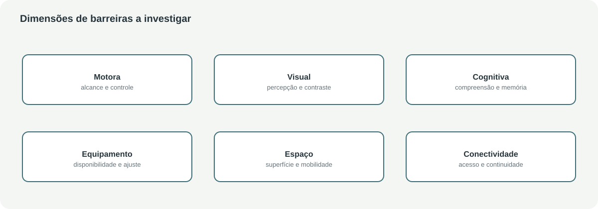
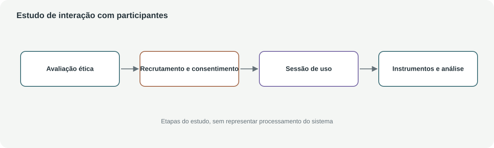
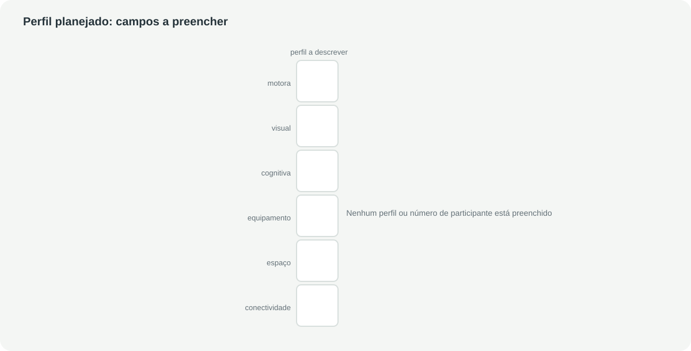

# Barreiras de acessibilidade em atividades de desenho assistidas por câmera

## Resumo

A avaliação de um sistema de desenho assistido por câmera pode medir saídas técnicas sem revelar se pessoas com necessidades e contextos diversos conseguem completar a atividade. Barreiras podem surgir de destreza, percepção, compreensão, equipamento, espaço físico ou conectividade; uma mesma condição não afeta todas as pessoas da mesma forma. Este artigo propõe uma auditoria de acessibilidade da interface digital, complementada por estudo de interação com participantes recrutados de modo inclusivo. O enquadramento organiza seis categorias de barreira e relaciona cada uma a critérios e métodos de avaliação. O protocolo combina revisão baseada nas WCAG 2.x, sessões de desenho, escala de usabilidade, avaliação de carga de trabalho e entrevista semiestruturada. Recrutamento, consentimento, adaptações e aprovação ética são definidos antes da coleta. Tabelas e figuras estruturam o plano sem descrever mecanismos internos. Como não há participantes ou dados de uso disponíveis, o artigo não afirma acessibilidade, desempenho ou experiência para qualquer grupo. A proposta busca tornar observáveis critérios e barreiras, limitando conclusões às pessoas, tarefas, materiais e contextos efetivamente estudados.

**Palavras-chave:** acessibilidade; desenho; interação; diversidade; avaliação

## Abstract

An evaluation of a camera-assisted drawing system may measure technical outputs without showing whether people with diverse needs and contexts can complete the activity. Barriers may arise from dexterity, perception, comprehension, equipment, physical space, or connectivity; the same condition does not affect everyone in the same way. This article proposes an accessibility audit of the digital interface, complemented by an interaction study with inclusively recruited participants. The framework organizes six barrier categories and relates each to criteria and evaluation methods. The protocol combines a review based on WCAG 2.x, drawing sessions, a usability scale, workload assessment, and a semi-structured interview. Recruitment, consent, accommodations, and ethics review are specified before data collection. Tables and figures organize the plan without describing internal mechanisms. Since no participants or usage data are available, the article makes no claim about accessibility, performance, or experience for any group. The proposal makes criteria and barriers observable while limiting conclusions to the people, tasks, materials, and contexts actually studied.

**Keywords:** accessibility; drawing; interaction; diversity; evaluation

## 1. Introdução

Um sistema de desenho assistido por câmera pode ser usado em diferentes espaços e por pessoas com distintas habilidades, equipamentos e estratégias. Uma avaliação baseada apenas em uma tarefa técnica não mostra se instruções são compreensíveis, se a interação é alcançável ou se o ambiente limita o uso. Acessibilidade não é uma propriedade que possa ser inferida de uma única taxa de acerto; ela envolve pessoas, tarefas, interfaces e contextos.

As barreiras podem ser motoras, visuais, cognitivas, relacionadas ao equipamento, ao espaço físico ou à conectividade. Elas podem coexistir e mudar com a tarefa. Uma postura confortável para uma pessoa pode ser difícil para outra; uma interface legível em uma tela pode depender de ampliar texto ou usar tecnologias assistivas. A avaliação deve perguntar quais pessoas conseguem realizar quais ações, sob quais condições e com que adaptações. Não se presume que cada participante represente um grupo inteiro nem que um diagnóstico prediga a experiência individual.

Diretrizes de acessibilidade para conteúdo digital oferecem critérios auditáveis de percepção, operação, compreensão e compatibilidade. Esses critérios são importantes para interface, instruções e materiais digitais, mas não cobrem sozinhos alcance físico, posição do papel, dispositivo disponível ou conectividade. Um estudo de interação pode revelar barreiras que uma auditoria de interface não identifica. Em sentido inverso, relatos de participantes não substituem inspeção sistemática de critérios publicados. A proposta combina as abordagens sem tratá-las como equivalentes.

A pergunta é: **quais barreiras motoras, visuais, cognitivas, de equipamento, de espaço e de conectividade influenciam a interação com um sistema de desenho assistido por câmera nas tarefas e contextos avaliados?** O estudo não parte da hipótese de que todas as barreiras ocorrerão nem de que participantes terão a mesma experiência. O objetivo é identificar condições, adaptações e diferenças relatadas, preservando o limite da amostra.

O artigo oferece três contribuições. Primeiro, apresenta uma taxonomia de barreiras e relaciona cada categoria a critérios e formas de avaliação. Segundo, propõe combinar auditoria de interface baseada em WCAG 2.x com sessões de uso e instrumentos de usabilidade, carga de trabalho e entrevista. Terceiro, descreve recrutamento, consentimento, adaptações e aprovação ética como parte do método. A contribuição é um protocolo de estudo, não evidência de acessibilidade já alcançada.

A seção 2 revisa diretrizes digitais, tecnologia assistiva, criação acessível e métodos de interação inclusiva. A seção 3 define as seis categorias e organiza os critérios. A seção 4 descreve a auditoria, o estudo, o recrutamento e os instrumentos. A seção 5 reserva campos para resultados futuros. A seção 6 discute interpretações possíveis. A seção 7 delimita validade e privacidade. A seção 8 sintetiza a proposta e a evidência necessária.

O estudo trata participação como colaboração de pesquisa, não como teste de capacidade individual. As instruções permitem acomodações pertinentes à atividade, como tempo de preparação, pausas, posição de trabalho escolhida e formas alternativas de resposta. Essas adaptações são registradas para contextualizar o resultado, não removidas como “ruído”. A equipe informa quais condições foram oferecidas e quais participantes as utilizaram, sem expor dados identificáveis.

O protocolo separa auditoria normativa, desempenho observado e experiência relatada. Uma falha em um critério de conteúdo pode existir sem impedir a tarefa imediata; uma pessoa pode completar a sessão e ainda encontrar esforço ou insegurança. Uma resposta positiva a um questionário não comprova conformidade com uma diretriz. Cada fonte de evidência responde a uma pergunta específica, e a interpretação usa a fonte adequada.

O estudo deve ser executado antes de qualquer afirmação sobre acessibilidade para públicos específicos. A proposta não conhece a diversidade de usuários, dispositivos e espaços que efetivamente participarão. O tamanho e a composição da amostra precisam ser justificados pelo objetivo e pela viabilidade, não preenchidos por contagens imaginadas. A equipe reporta limitações de recrutamento e busca incluir experiências relevantes sem prometer representação universal.

## 2. Trabalhos relacionados

### 2.1 Acessibilidade digital e diretrizes

As Web Content Accessibility Guidelines (WCAG) organizam critérios para tornar conteúdo digital perceptível, operável, compreensível e compatível com tecnologias assistivas [1, 2]. Auditorias podem examinar contraste, alternativas textuais, navegação, foco, estrutura, linguagem e mensagens de estado. A conformidade é avaliada por critério e nível, com evidência observável. Uma checklist sem registro de falhas, contexto e versão não é suficiente para comparação.

WCAG é uma referência para conteúdo e interfaces digitais; não é uma avaliação completa de interação física com papel, câmera ou superfície de desenho. Uma auditoria pode identificar barreiras em instruções, controles ou mensagens e ainda não revelar se uma pessoa consegue posicionar o papel ou operar o equipamento. Por isso, este artigo aplica diretrizes ao que é conteúdo digital avaliável e complementa a análise com tarefas e relatos. As versões publicadas do padrão são identificáveis e mantêm critérios próprios; o estudo deve declarar qual edição foi usada, sem tratar recomendações informativas como requisitos normativos [1, 2, 6].

Diretrizes para ferramentas de autoria ampliam o foco: além do conteúdo produzido, consideram a acessibilidade do processo de criação e a capacidade de autores com deficiência participarem da produção [3]. A especificação WAI-ARIA define semântica de componentes para tecnologias assistivas, enquanto as práticas de autoria orientam padrões de interação para componentes ricos [4, 5]. Aplicá-las exige observar a interface real; mencionar compatibilidade no projeto não constitui evidência de operação adequada. A orientação para conteúdo cognitivo ajuda a formular linguagem clara, navegação previsível e apoio à compreensão, mas não substitui consulta a participantes [6].

O documento WCAG2ICT adapta a discussão de critérios para tecnologias de informação e comunicação que não são páginas web [7]. Essa referência evita supor que todo elemento de uma atividade física esteja coberto por uma norma de conteúdo digital. A Convenção sobre os Direitos das Pessoas com Deficiência estabelece participação, acessibilidade e igualdade como princípios de direitos humanos [8]. Neste estudo, esses princípios informam o respeito às escolhas de participação, mas não são convertidos em um escore técnico de produto.

Auditorias automatizadas podem ajudar a encontrar problemas simples, mas sua cobertura depende do conteúdo, da ferramenta e do critério. A equipe precisa revisar manualmente navegação, textos, estados e compatibilidade assistiva que possam ser avaliados. O relato registra cada critério aplicável, o método de inspeção e exemplos observáveis. Critérios não aplicáveis são distinguidos de critérios que não puderam ser avaliados. Essa distinção impede que ausência de evidência seja apresentada como conformidade.

### 2.2 Tecnologia assistiva e criação

Tecnologia assistiva inclui recursos que ampliam ou substituem formas de interação, percepção e comunicação. O desenho baseado em habilidades propõe adaptar a interação às capacidades e preferências demonstradas pela pessoa, em vez de reduzir o projeto a categorias clínicas [22]. Estudos críticos de tecnologia assistiva alertam que soluções e avaliações podem reproduzir pressupostos sobre deficiência quando não consideram barreiras sociais, escolha e contexto [23]. A descrição da sessão deve, portanto, registrar recursos escolhidos pelos participantes sem tratá-los como falha ou exceção.

Estudos sobre leitores de tela documentam obstáculos em tarefas web e mostram por que relatos de usuários complementam verificações técnicas [25]. Trabalhos sobre o uso social de tecnologia assistiva também indicam que uma adaptação pode afetar não só uma ação, mas a interação com outras pessoas e o ambiente [24]. Essas conclusões orientam perguntas de pesquisa, mas não autorizam presumir que a mesma dificuldade apareça no desenho em papel acompanhado por câmera. A unidade de análise permanece a tarefa e o contexto observados.

Pesquisa de prática de desenho por pessoas cegas descreve estratégias para criar informação gráfica sem depender exclusivamente do canal visual [26]. Uma ferramenta de desenho baseada em grade foi estudada como apoio a esse tipo de atividade [27]. Avaliações posteriores investigaram técnicas de criação gráfica com pessoas cegas ou com baixa visão [28]. Esses estudos demonstram que criação acessível é um campo com objetivos e estratégias diversos, não um requisito uniforme de “substituir a visão”.

Trabalhos recentes sobre arte digital acessível examinam barreiras linguísticas e formas de tornar pranchas digitais utilizáveis por pessoas cegas ou com baixa visão [29, 30]. A literatura de ferramentas de desenho para pessoas com deficiência visual descreve adaptações e decisões de projeto em tarefas específicas [31]. Os cenários digitais diferem de uma atividade que combina papel e câmera; as contribuições são usadas para delimitar questões de acesso, não para reivindicar equivalência entre ferramentas.

Desenho pode ser comunicação, expressão, planejamento ou lazer. A finalidade modifica o que conta como sucesso e quais barreiras importam. Para uma pessoa, precisão do traço pode ser central; para outra, registrar e compartilhar uma ideia pode ser suficiente. A pesquisa de criação acessível recomenda consultar participantes e observar estratégias próprias, em vez de impor um padrão único de produto. O estudo proposto pergunta que resultado cada pessoa busca antes de interpretar uma tarefa como concluída ou interrompida.

### 2.3 Estudos de interação inclusiva

Estudos inclusivos discutem recrutamento, consentimento acessível, compensação, adaptações, risco de coerção e participação em decisões de pesquisa. O Relatório Belmont articula respeito às pessoas, beneficência e justiça para pesquisa com participantes [9]. Estudos de HCI sobre ética situada mostram que o consentimento pode requerer diálogo e atenção à relação entre participantes e equipe, principalmente quando comunicação, memória ou autonomia variam [10]. A proposta exige aprovação ética antes do recrutamento e adapta o modo de consentir sem reduzir a informação fornecida.

Escalas padronizadas, como a System Usability Scale (SUS), oferecem uma medida breve de usabilidade percebida [11]. Estudos e revisões discutem propriedades, interpretação e usos da escala [12, 13]. A NASA Task Load Index (NASA-TLX) foi criada como instrumento subjetivo de carga de trabalho e pode ser aplicada após uma atividade delimitada [14, 15]. Comparações com outros instrumentos ressaltam que medidas de carga respondem a perguntas distintas e não devem ser interpretadas como diagnóstico de capacidade [16]. Um manual de métodos de experiência de usuário ajuda a planejar apresentação, análise e incerteza das medidas [17].

SUS e NASA-TLX não descrevem todas as barreiras. A forma de administração pode, por si, ser inacessível: texto pequeno, leitura em voz alta não escolhida, resposta motora difícil ou linguagem pouco clara. O protocolo oferece modalidades de resposta equivalentes e registra adaptações que possam alterar a comparabilidade. Não modifica itens padronizados sem identificar a adaptação, porque mudanças podem invalidar comparações com aplicações anteriores. Quando uma versão acessível validada não estiver disponível para a situação, o resultado é relatado como exploratório.

Entrevistas semiestruturadas permitem explorar estratégias, adaptações e dificuldades não previstas. A análise temática exige explicitar como os dados foram codificados, como interpretações foram discutidas e como a posição da equipe pode influenciar a leitura [18]. Critérios de relato qualitativo e listas de transparência oferecem perguntas para documentar recrutamento, contexto, coleta e análise [19, 20]. Eles orientam a transparência do relato, mas não funcionam como garantias automáticas de qualidade.

Pesquisas que relacionam acessibilidade e usabilidade mostram que as duas áreas se sobrepõem sem serem idênticas [21]. Uma interação pode parecer fácil para uma pessoa e permanecer inacessível a outra; uma barreira normativa pode ser detectada mesmo sem relato espontâneo de dificuldade. A lacuna é combinar auditoria de diretrizes digitais com um protocolo inclusivo de interação para desenho em papel assistido por câmera. Diretrizes ajudam a encontrar falhas observáveis na interface; tarefas e relatos ajudam a entender o uso situado. Nenhuma fonte isolada permite generalizar para todos os usuários. Este artigo articula essas fontes e define limites de recrutamento, interpretação e reporte.

## 3. Enquadramento do problema

Uma avaliação útil transforma “acessibilidade” em perguntas sobre ações, condições e consequências observáveis. A barreira é uma incompatibilidade entre uma tarefa ou ambiente e as necessidades, estratégias ou recursos disponíveis para uma pessoa. Ela não reside exclusivamente no corpo, na interface ou no espaço. Uma mesma pessoa pode realizar a atividade em um ambiente e encontrar obstáculo em outro, ou pode alternar estratégias durante uma sessão. O enquadramento organiza observações em seis categorias para que a equipe registre o que ocorreu sem deduzir uma causa médica.

A tabela relaciona cada barreira a um critério operacional e a uma forma de avaliação. O critério descreve uma condição a observar, não um padrão universal. As medidas podem ser qualitativas ou quantitativas conforme a pergunta, e unidades devem ser definidas antes da coleta. O relatório separa evidência direta, interpretação e explicação sugerida pela pessoa participante. A ausência de uma ocorrência na amostra não prova que a barreira não exista em outro contexto.

**Tabela 1.** Matriz de barreiras, critérios de acessibilidade e formas de avaliação, considerando necessidades diversas sem generalizar além das pessoas e contextos estudados; elaboração própria para orientar observação contextual.

| Barreira | Critério observável | Como avaliar |
|---|---|---|
| Motora | A pessoa pode posicionar, iniciar, continuar e concluir a tarefa com sua estratégia escolhida. | Observar ações interrompidas, assistência solicitada, adaptação de postura e relato de esforço. |
| Visual | Instruções, estado da atividade e resultado podem ser percebidos por recursos compatíveis com a preferência individual. | Inspecionar contraste e alternativas digitais; perguntar quais sinais foram percebidos e por qual canal. |
| Cognitiva | A tarefa, a sequência de instruções e os estados relevantes são compreensíveis sem depender de memória desnecessária. | Solicitar que a pessoa explique o que espera, registrar hesitações e perguntar como interpretou cada mensagem. |
| Equipamento | Os recursos disponíveis podem ser posicionados e usados com segurança no contexto escolhido. | Registrar tipo de recurso em categorias amplas, compatibilidade declarada, ajustes e impedimentos encontrados. |
| Espaço | A superfície, o assento, a iluminação e o alcance permitem configurar a atividade de modo confortável. | Mapear condições físicas relevantes, escolhas de posição, pedidos de mudança e pausas. |
| Conectividade | A sessão e os materiais necessários podem ser acessados sem impor uma dependência incompatível com o contexto. | Verificar acesso antes da sessão, registrar interrupções e oferecer alternativa de participação quando possível. |

A Figura 1 resume as seis categorias para apoiar a leitura da taxonomia, sem sugerir que cada pessoa pertença a uma única categoria ou que as barreiras sejam independentes.

**Figura 1.** Mapa conceitual de barreiras motoras, visuais, cognitivas, de equipamento, de espaço e de conectividade em atividades de desenho; elaboração própria para organizar categorias sem classificar participantes.

**3.1 Barreiras motoras.** Controle fino, alcance, postura, fadiga, dor e coordenação podem influenciar ações distintas. A equipe não pede que a pessoa demonstre uma habilidade isolada nem define uma postura padrão. Registra se posicionar o papel, segurar o instrumento ou responder a uma instrução exigiu mudança, pausa ou ajuda. O relato da pessoa esclarece se uma dificuldade é relevante para sua atividade ou se faz parte de uma estratégia confortável. A assistência oferecida é descrita para distinguir desempenho independente, assistência solicitada e adaptação aceita. Essa descrição não deve transformar independência em objetivo superior quando o propósito é permitir participação.

Uma mesma ação observável pode ter explicações diferentes. Uma pausa pode indicar descanso escolhido, planejamento do desenho, interrupção externa ou dificuldade motora. A anotação contextual inclui o que a pessoa informou e evita atribuir causa apenas pelo vídeo. Se houver observação audiovisual, ela deve ser consentida especificamente e limitada ao necessário. O protocolo permite que a pessoa interrompa a gravação sem perder o direito de continuar a sessão.

**3.2 Barreiras visuais.** Contraste, tamanho, localização, consistência visual e dependência exclusiva de cor podem afetar a percepção de instruções e estados digitais. A avaliação visual da interface usa critérios aplicáveis da WCAG, além de verificar alternativas textuais e ordem de leitura quando há conteúdo não textual [1]. A interação física pode depender de iluminação, orientação do papel e sinais visuais; essas condições são descritas sem assumir que todos os participantes percebem ou interpretam da mesma forma. Pessoas com baixa visão podem preferir ampliação, proximidade, contraste ou combinação de canais. Pessoas cegas podem usar outras estratégias, e a equipe pergunta quais são relevantes em vez de impor uma solução.

A auditoria e a sessão respondem a perguntas distintas. Uma verificação de contraste pode demonstrar que um critério foi atendido ou falhou em um componente digital. Ela não prova que a tarefa inteira seja acessível. Uma pessoa pode identificar uma mensagem e ainda não entender o que fazer; outra pode realizar a tarefa por experiência prévia mesmo diante de informação inacessível. O relato registra ambos os fatos sem apagar uma fonte em favor da outra.

**3.3 Barreiras cognitivas.** Compreensão, atenção, memória, leitura e expectativa podem interagir com instruções longas, termos ambíguos, mensagens transitórias ou mudanças inesperadas. A equipe oferece instruções em linguagem clara e verifica se a pessoa as compreendeu sem transformar a sessão em prova escolar. Perguntas abertas ajudam a identificar vocabulário não familiar, objetivos divergentes e interpretações alternativas. O silêncio não é tratado automaticamente como compreensão.

Uma adaptação de linguagem é documentada junto com sua razão e momento. Simplificar uma instrução durante a sessão pode melhorar a participação, mas também altera a tarefa original. O protocolo registra o que foi apresentado e o que foi ajustado, possibilitando analisar se os episódios são comparáveis. Elementos de apoio, como repetição ou consulta às instruções, não são considerados erro quando fazem parte do uso previsto. A análise busca identificar informação ausente ou ambígua no contexto concreto.

**3.4 Barreiras de equipamento.** Recursos necessários podem não estar disponíveis, ser incompatíveis, depender de bateria ou exigir instalação e configuração. A avaliação pergunta quais recursos a pessoa usa regularmente e se prefere utilizá-los durante a sessão. O inventário registra categorias amplas e ajustes relevantes, evitando coletar marca, número de série ou identificadores que não sejam necessários. Um recurso emprestado pode oferecer alternativa, mas pode também exigir familiarização; a equipe pergunta se a pessoa deseja usá-lo e distingue essa condição de seu ambiente habitual.

Compatibilidade precisa ser observada na tarefa, não inferida de uma lista de suporte. Se um dispositivo não puder ser usado, registra-se o motivo e o ponto em que a atividade foi afetada. Se a pessoa optar por não usar um recurso oferecido, essa decisão é respeitada. A análise distingue indisponibilidade institucional, preferência pessoal e incompatibilidade observada, sem culpabilizar o participante.

**3.5 Barreiras de espaço.** Alcance da mesa, estabilidade da superfície, posição do assento, iluminação, ruído, circulação e privacidade podem influenciar a sessão. O espaço deve permitir escolhas de postura e acomodação de dispositivos que a pessoa utiliza. Quando isso não for possível, a restrição é registrada como característica do local. A equipe não considera uma postura de laboratório como referência universal de conforto.

Também é necessário considerar tarefas remotas e domiciliares. Elas podem ampliar a escolha de ambiente ou reduzir deslocamento, mas dependem de espaço e privacidade sob controle do participante. A equipe pergunta se existe uma condição mais confortável e aceita reagendamento ou modalidade alternativa quando viável. Uma escolha metodológica que exclua pessoas por falta de espaço adequado reduz a validade externa e deve ser discutida.

**3.6 Barreiras de conectividade.** Acesso à rede, estabilidade da conexão, custo de dados e disponibilidade de dispositivo podem determinar se a pessoa consegue participar de uma sessão remota ou acessar materiais. Conectividade não é atributo individual; depende de serviço, localização, equipamento e condições socioeconômicas. O estudo oferece instruções acessíveis com antecedência e informa requisitos de acesso antes do consentimento. A equipe considera uma modalidade presencial ou offline quando ética e logisticamente possível.

Uma interrupção de rede deve ser distinguida de uma interrupção da atividade por outra causa. A pessoa pode preferir não continuar depois de uma falha, sem que isso seja registrado como insucesso pessoal. Se a conexão afeta uma medida de uso, a análise documenta o episódio, a decisão tomada e se os dados permaneceram utilizáveis. Essas decisões são definidas previamente para evitar exclusão seletiva após conhecer resultados.

As categorias podem se cruzar: uma interface visualmente carregada pode aumentar demanda cognitiva; uma mesa inacessível pode dificultar o uso de um recurso assistivo; conexão instável pode interromper uma instrução. A equipe registra categoria primária apenas quando isso facilita a organização e preserva outras interpretações como relações entre barreiras. O quadro não serve para classificar participantes. Ele serve para organizar perguntas, observações e propostas de melhoria sem inferir diagnóstico ou universalidade.

## 4. Protocolo de avaliação proposto

O protocolo combina auditoria digital com estudo de interação. A auditoria examina conteúdo, controles, instruções e estados digitais que fazem parte da atividade, usando a edição publicada da WCAG declarada no relatório [1]. Para outros materiais digitais, os critérios WCAG2ICT podem orientar a seleção de itens pertinentes [7]. A equipe define antes da inspeção o nível de conformidade desejado, as páginas ou telas avaliadas, tecnologias assistivas consideradas e condições de teste. Não se declara conformidade global a partir de uma seleção parcial de critérios.

Cada verificação inclui o critério, a condição em que se aplica, a forma de inspeção, a evidência observada, o estado e a justificativa. Estados incluem conforme, não conforme, não aplicável ou não verificado, sempre com observação. A inspeção automatizada pode complementar a revisão, mas não decide sozinha se o conteúdo é acessível. A avaliação manual verifica navegação, foco, nomes acessíveis, mensagens, estrutura e compreensão sempre que os elementos estiverem presentes. Mudanças entre sessões são registradas para que uma auditoria possa ser repetida.

O estudo com pessoas começa somente depois da aprovação do comitê de ética aplicável. A proposta, os materiais de recrutamento, o processo de consentimento e a forma de lidar com gravações devem ser aprovados antes de convidar participantes. A equipe explica finalidade, duração estimada em termos práticos, atividades solicitadas, riscos previsíveis, compensação quando houver, dados coletados, acesso, retenção e contato para dúvidas. O consentimento é informado, voluntário e apresentado em formato acessível. A pessoa pode fazer perguntas, aceitar ou recusar gravação separadamente e interromper sua participação sem penalidade.

Os critérios de recrutamento são formulados pela pergunta de pesquisa. A equipe busca diversidade de experiências relevantes para as barreiras motoras, visuais, cognitivas, de equipamento, espaço e conectividade, sem exigir diagnóstico como condição padrão. Critérios de inclusão e exclusão são justificados; exclusões por idioma, dispositivo, transporte ou capacidade de realizar a tarefa precisam ser declaradas e examinadas como possíveis fontes de viés. Não há uma composição numérica definida antes da avaliação de viabilidade. A equipe documenta quais redes de recrutamento foram utilizadas e quais grupos podem permanecer ausentes.

A pessoa interessada recebe uma descrição da atividade e pode indicar preferências de comunicação, posição, pausas e recursos assistivos. Essa conversa não pede detalhes médicos desnecessários. A equipe confirma as adaptações antes de iniciar e pergunta se continuam adequadas durante a sessão. Não se fotografa ou grava mais do que o protocolo aprovado exige. Se dados visuais forem necessários, o enquadramento evita rosto, documentos pessoais e ambiente privado sempre que possível; a decisão final é aprovada no protocolo ético.

A sessão oferece uma tarefa de desenho definida em termos do objetivo da pessoa e do estudo. Antes da tarefa, há tempo para conhecer materiais, escolher uma posição e fazer perguntas. A instrução é lida ou apresentada no formato escolhido. Durante a atividade, o facilitador evita orientar cada ação, mas oferece ajuda se solicitada e registra quando uma intervenção altera a tarefa. A pessoa pode pausar, mudar a estratégia ou encerrar. O procedimento não exige que participantes revelem informações de saúde nem que demonstrem uma habilidade específica.

A observação registra conclusão ou interrupção da tarefa, assistência solicitada, adaptação utilizada, barreiras relatadas, dúvidas, erros de compreensão e comentários espontâneos. Categorias de registro são definidas antes da análise e descritas em um guia para a equipe. Um segundo pesquisador pode revisar uma amostra consentida dos registros para discutir ambiguidades, mas isso não converte interpretação qualitativa em medida objetiva automática. Divergências são examinadas e o relatório descreve como foram resolvidas.

Após a tarefa, a SUS pode ser oferecida para resumir usabilidade percebida [11]. O protocolo apresenta itens em um formato acessível e sem induzir resposta. A NASA-TLX pode caracterizar a carga de trabalho percebida em dimensões próprias do instrumento [14, 15]. A ordem, o modo de resposta e qualquer adaptação são registrados. Se a participante preferir responder oralmente, um pesquisador pode transcrever sem reformular. Uma versão alterada não recebe interpretação normativa como se fosse idêntica ao instrumento original.

A entrevista semiestruturada investiga o que ajudou ou dificultou, quais sinais foram compreendidos, que recursos foram necessários e como a pessoa avaliaria a atividade em seu uso cotidiano. Perguntas abertas vêm antes de sondagens específicas para reduzir sugestão. O facilitador permite tempo de resposta e formas alternativas de comunicação aprovadas. A análise temática descreve familiarização, codificação, agrupamento e revisão de temas, além da posição dos pesquisadores [18]. O relato qualitativo usa recomendações de transparência pertinentes, sem apresentar checklist como prova de validade [19, 20].

Os instrumentos e limites estão resumidos na Tabela 2. Nenhum instrumento isolado responde se uma pessoa teve acesso equitativo à atividade. SUS e NASA-TLX fornecem respostas subjetivas estruturadas; observação contextualiza o desempenho; entrevista explica significados e estratégias; auditoria identifica critérios digitais. A síntese compara as fontes e preserva divergências em vez de forçar concordância.

**Tabela 2.** Instrumentos para auditoria, usabilidade, carga de trabalho e relato qualitativo, indicando evidência, modo de aplicação e limites interpretativos de cada fonte neste protocolo; elaboração própria.

| Instrumento | Evidência produzida | Aplicação e limite |
|---|---|---|
| Auditoria WCAG | Conformidade observável de critérios digitais aplicáveis. | Inspeção manual apoiada por ferramentas; não cobre toda a atividade física. |
| Observação da tarefa | Ações, interrupções, pedidos de ajuda e adaptações. | Registro contextual; não infere sozinho a causa de uma dificuldade. |
| System Usability Scale | Percepção global de usabilidade após a tarefa. | Questionário padronizado; acessibilidade do modo de resposta precisa ser verificada. |
| NASA Task Load Index | Percepção multidimensional de carga de trabalho. | Aplicada após uma tarefa delimitada; não é diagnóstico de capacidade. |
| Entrevista semiestruturada | Significados, estratégias, barreiras não previstas e preferências. | Análise interpretativa exige reflexividade e transparência. |
| Registro de contexto | Equipamento, ambiente, conectividade e acomodações relevantes. | Coletar apenas dados necessários; evitar identificadores e detalhes de saúde. |

A Figura 2 situa a ordem externa de aprovação, participação e coleta, sem representar etapas internas do sistema ou antecipar como a atividade ocorrerá em cada contexto.

**Figura 2.** Fluxo externo de avaliação ética, recrutamento, consentimento, sessão e instrumentos, sem descrever o funcionamento interno do sistema; elaboração própria para situar as etapas da pesquisa com pessoas.

Como a composição ainda não foi observada, a Figura 3 deixa campos vazios e serve somente como lembrete de descrição contextual agregada após recrutamento.

**Figura 3.** Perfil planejado da amostra com campos vazios para descrever diversidade e necessidades de acesso após recrutamento; não representa participantes ou contagens; elaboração própria como guia para relato agregado.

O perfil da amostra é descrito em categorias escolhidas com justificativa e consentimento. O pesquisador evita tabelas que permitam identificar uma pessoa por combinação rara de características. Se um relato incluir dado pessoal, a equipe remove ou generaliza detalhes que não sejam essenciais, desde que isso preserve o sentido. Os resultados incluem as condições que tornam uma interpretação plausível e as situações ausentes, sem estender achados para a população em geral.

As análises quantitativas começam por estatísticas descritivas compatíveis com a distribuição e com o desenho do estudo. A equipe relata denominadores, dados ausentes, adaptações e incerteza, sem transformar uma amostra de conveniência em estimativa populacional. Comparações exploratórias entre perfis só são feitas quando houver base ética e metodológica suficiente. A análise qualitativa é conduzida em paralelo para contextualizar diferenças e resultados inesperados. Nenhuma associação é interpretada como efeito causal da deficiência, de uma tecnologia assistiva ou de uma condição ambiental.

A equipe mantém um registro de decisões metodológicas, versões dos materiais, desvios de protocolo e justificativas. O registro não expõe informações pessoais e não inclui detalhes internos do sistema. Uma mudança de tarefa, instrução ou instrumento deve ser descrita para que o leitor saiba quais sessões podem ser comparadas. A comparação entre auditoria e relatos é feita por questão: quais critérios digitais falharam, quais barreiras foram observadas, quais foram relatadas e quais permaneceram sem explicação.

## 5. Estrutura dos resultados

Nenhum estudo com participantes foi concluído para este artigo. Portanto, não há evidência para afirmar conformidade, facilidade de uso, carga de trabalho, barreira observada ou experiência de qualquer grupo. A seção permanece como estrutura de reporte até que o protocolo receba aprovação ética e a coleta seja executada.

| Bloco de resultado | Conteúdo futuro |
|---|---|
| Auditoria digital | [PENDENTE-DADOS] Critérios aplicáveis, método, evidência, estado e justificativa. |
| Interação | [PENDENTE-DADOS] Tarefas, interrupções, pedidos de ajuda e adaptações, com contexto. |
| Questionários | [PENDENTE-DADOS] Respostas e dados ausentes, sem extrapolação populacional. |
| Entrevistas | [PENDENTE-DADOS] Temas, exemplos anonimizados e procedimento analítico. |
| Perfil e contexto | [PENDENTE-DADOS] Caracterização agregada que não permita identificar participantes. |

O relatório futuro deverá distinguir achados da auditoria, observações da sessão, respostas a instrumentos e interpretações da equipe. Se participantes relatarem uma barreira não prevista, ela será descrita como tema emergente, com contexto suficiente e proteção de identidade. Se uma categoria não aparecer, o texto indicará o limite de observação em vez de concluir que a barreira inexiste. Nenhuma linha será preenchida por expectativa teórica ou pela literatura citada.

Resultados negativos, falhas de procedimento e impossibilidade de completar uma tarefa também serão reportados quando o consentimento e a proteção de dados permitirem. A equipe informará se adaptações foram usadas e se modificaram a tarefa. A análise só associará dados entre instrumentos quando houver justificativa e dados suficientes. Até que a coleta esteja concluída, a conclusão permanece restrita ao protocolo proposto.

Qualquer comparação será acompanhada de descrição do contexto e da incerteza. Os resultados devem permitir que leitores distingam ausência de barreira observada de ausência de oportunidade para observá-la. A tabela funciona como estrutura de relato, não como registro de achados atuais.

## 6. Discussão

O protocolo trata acessibilidade como evidência situada e organizada em camadas. Uma auditoria pode apontar que um critério digital aplicável falhou, enquanto participantes ainda completam a tarefa por experiência prévia ou estratégia alternativa. A conclusão apropriada é que a tarefa foi concluída sob aquelas condições; a falha normativa ainda exige correção e investigação. O caso inverso também é possível: uma inspeção não encontra falha nos critérios revisados, mas participantes relatam dificuldade relacionada ao espaço, equipamento ou significado da atividade. A auditoria não cobre essas barreiras sozinha.

Se diferentes participantes escolherem estratégias distintas, essa variação não deve ser tratada como ruído. Ela pode indicar que a tarefa admite caminhos múltiplos, que uma acomodação foi útil ou que a instrução deixa margem para interpretações diferentes. A equipe separa a observação do julgamento sobre a qualidade da estratégia. A literatura de desenho acessível documenta práticas criativas diversas [26–31]; este estudo deve verificar como essas práticas aparecem em seu contexto, sem presumir que uma modalidade de criação represente todas as demais.

Uma diferença entre pontuações de questionário e entrevista não é necessariamente contradição. SUS oferece uma avaliação global; NASA-TLX aborda carga percebida; entrevistas podem revelar um aspecto específico que não altera uma pontuação geral [11, 14]. Um escore favorável não cancela uma barreira relatada, assim como uma tarefa concluída não comprova esforço aceitável. O relatório apresenta cada instrumento com seu objetivo, modo de administração e limitações. Mudanças na forma de resposta são explicitadas antes de comparar resultados com estudos prévios.

As categorias da matriz ajudam a planejar observação, mas uma barreira pode atravessar várias delas. Uma tela pequena pode apresentar um desafio visual e exigir estratégia motora diferente; conectividade instável pode tornar uma instrução difícil de retomar. Uma análise que force cada episódio em uma única categoria perde relações importantes. Por outro lado, atribuir causas sem evidência direta também é inadequado. Uma interpretação cuidadosa preserva simultaneamente a descrição observada e a explicação oferecida pelo participante.

Recrutamento inclusivo e consentimento acessível não são tarefas administrativas separadas da qualidade científica. Eles influenciam quem pode participar, quais dados são produzidos e quais conclusões podem ser sustentadas. Se a equipe só conseguir recrutar pessoas com determinado dispositivo ou acesso a espaço, esse limite afeta a validade externa. Se participantes não entenderem a informação de consentimento, a validade ética da coleta é afetada. A aprovação ética, o diálogo e o registro de adaptações são partes do método [9, 10].

O resultado mais informativo pode ser identificar uma barreira que não estava prevista, ou mostrar que um critério técnico é insuficiente para explicar a experiência. Isso não significa que o protocolo falhou. Significa que a pergunta inicial precisa ser refinada e que futuros estudos podem priorizar observações ou participantes ainda ausentes. A análise temática e os padrões de reporte qualitativo contribuem para tornar o percurso interpretativo examinável [18–20].

Uma comparação entre grupos só deve ser feita com justificativa, proteção contra identificação e interpretação compatível com a amostra. Diferenças em um grupo pequeno podem refletir contexto, experiência, tarefa ou modo de resposta. A equipe não deve converter uma diferença em recomendação para todas as pessoas com um mesmo diagnóstico. A contribuição potencial do estudo está em descrever interações e necessidades situadas, não em fixar uma ordem de capacidade entre grupos.

Por fim, resultados da auditoria podem gerar uma lista de correções e uma nova inspeção. Resultados de interação podem orientar mudanças de instrução, material, ambiente ou política de recrutamento. Qualquer mudança precisa ser testada com as pessoas afetadas e, quando houver interação com participantes, seguir o processo ético pertinente. A acessibilidade não é confirmada por uma única sessão; é uma obrigação contínua de revisar critérios, ouvir participantes e relatar limites.

## 7. Limitações e ameaças à validade

**Validade de construção.** Acessibilidade, usabilidade, carga de trabalho e participação são conceitos relacionados, mas não intercambiáveis. WCAG avalia critérios de conteúdo digital, SUS resume percepção de usabilidade e NASA-TLX descreve carga percebida. Nenhum deles representa sozinho a experiência total. A matriz de barreiras é uma estrutura de organização proposta, não uma escala validada. Uma interpretação futura deve evitar tratar a quantidade de observações em cada categoria como severidade ou prevalência.

**Validade interna.** A familiaridade com papel, instrução, material ou facilitador pode alterar a interação. Ajuda oferecida pela equipe pode reduzir uma barreira ou mudar a tarefa. A gravação pode influenciar o comportamento; por isso, precisa ser consentida e limitada. Se houver mudança do procedimento entre sessões, a comparação pode ficar comprometida. O protocolo registra intervenções e desvios, sem afirmar que todos os fatores de confusão podem ser controlados em uma sessão de uso.

**Validade externa.** Participantes recrutados por organizações, redes pessoais ou espaços acessíveis podem não refletir quem está ausente dessas redes. Uma sessão presencial não representa uso remoto; um ambiente doméstico não representa um local de aula ou trabalho. Recursos disponíveis variam entre regiões e pessoas. O estudo deve descrever amostra e contexto com cuidado para não permitir reidentificação e limitar suas conclusões às condições examinadas.

**Validade de dados e interpretação.** Questionários podem ser difíceis de compreender ou responder em um formato específico. Adaptações melhoram acesso, mas podem alterar comparabilidade. Entrevistas dependem da relação com o pesquisador e da interpretação analítica. Transcrição, anonimização ou tradução podem remover nuances. O protocolo informa procedimentos, perdas e decisões. A triangulação não resolve automaticamente discrepâncias: ela ajuda a localizar qual pergunta cada fonte responde.

**Ética e privacidade.** Participantes podem revelar informações sensíveis ao explicar uma barreira ou uma acomodação. Coletar diagnóstico, vídeo ou dados ambientais aumenta risco sem ser necessário para todas as perguntas. A equipe minimiza a coleta, restringe acesso, define retenção e relata qualquer compartilhamento autorizado. Consentimento não elimina o dever de proteção. A possibilidade de retirada e a recusa de gravação devem ser compatíveis com o desenho do estudo.

**Escopo normativo.** A edição e o nível de WCAG escolhidos limitam o que a auditoria pode afirmar. Critérios não aplicáveis, materiais de terceiros e elementos físicos estão fora de partes da inspeção. Uma auditoria parcial não autoriza anunciar conformidade total. A equipe declara o escopo e inclui as limitações do método de avaliação. As recomendações normativas devem ser atualizadas para a edição declarada, sem tratar notas informativas como requisitos.

## 8. Conclusão

Este artigo propõe avaliar barreiras motoras, visuais, cognitivas, de equipamento, de espaço e de conectividade em atividades de desenho assistidas por câmera. O quadro conecta cada categoria a critérios observáveis e formas de investigação, e o protocolo combina auditoria digital, sessão com participantes, questionários e entrevista. A proposta delimita a diferença entre conformidade, desempenho observado e experiência relatada.

Ainda não há resultados para sustentar uma afirmação sobre acessibilidade do sistema ou sobre qualquer grupo. O próximo passo é submeter o protocolo ao comitê de ética, preparar materiais acessíveis, recrutar participantes de forma justificada e executar sessões com adaptações escolhidas em diálogo. O relato deverá proteger a identidade, apresentar evidências por fonte e declarar quem ou o que ficou fora do estudo. As conclusões devem permanecer ligadas às pessoas, tarefas e contextos efetivamente avaliados.

Somente uma coleta ética, documentada e interpretada com participação das pessoas poderá sustentar recomendações concretas. O protocolo oferece critérios para produzir essa evidência sem antecipar seus resultados.

## Declarações

- Uso de IA: texto redigido com apoio de IA generativa, com revisão e responsabilidade dos autores; referências conferidas por DOI ou página primária.
- Dados: nenhum dado de participantes foi coletado para esta proposta.
- Código: não há código de análise ou de coleta associado a resultados neste artigo.
- Conflito de interesses: os autores devem declarar conflitos relacionados ao estudo antes da submissão.
- Ética: o protocolo será submetido ao comitê de ética em pesquisa aplicável antes do recrutamento; consentimento acessível será obtido antes de qualquer sessão.
- Contribuição dos autores: a definir pelos autores conforme suas contribuições efetivas.

## Referências

[1] W3C. Web Content Accessibility Guidelines (WCAG) 2.2. W3C Recommendation, 2023. https://www.w3.org/TR/2023/REC-WCAG22-20231005/
[2] W3C. Web Content Accessibility Guidelines (WCAG) 2.1. W3C Recommendation, 2018. https://www.w3.org/TR/2018/REC-WCAG21-20180605/
[3] Richards, J.; Spellman, J.; Treviranus, J. Authoring Tool Accessibility Guidelines (ATAG) 2.0. W3C Recommendation, 2015. https://www.w3.org/TR/2015/REC-ATAG20-20150924/
[4] W3C. Accessible Rich Internet Applications (WAI-ARIA) 1.2. W3C Recommendation, 2023. https://www.w3.org/TR/wai-aria-1.2/
[5] W3C ARIA Working Group. WAI-ARIA Authoring Practices 1.2. W3C Group Note, 2021. https://www.w3.org/TR/2021/NOTE-wai-aria-practices-1.2-20211129/
[6] W3C Cognitive and Learning Disabilities Accessibility Task Force. Making Content Usable for People with Cognitive and Learning Disabilities. W3C Working Group Note, 2021. https://www.w3.org/TR/2021/NOTE-coga-usable-20210429/
[7] W3C. Guidance on Applying WCAG 2 to Non-Web Information and Communications Technologies (WCAG2ICT). W3C Group Note, 2023. https://www.w3.org/WAI/standards-guidelines/wcag/non-web-ict/
[8] United Nations General Assembly. Convention on the Rights of Persons with Disabilities. Resolution 61/106, 2006. https://www.un.org/disabilities/documents/convention/convention_accessible_pdf.pdf
[9] National Commission for the Protection of Human Subjects of Biomedical and Behavioral Research. The Belmont Report: Ethical Principles and Guidelines for the Protection of Human Subjects of Research. 1979. https://www.hhs.gov/ohrp/regulations-and-policy/belmont-report/read-the-belmont-report/index.html
[10] Hodge, J.; Foley, S.; Brankaert, R.; Kenning, G.; Lazar, A.; Boger, J.; Morrissey, K. Relational, Flexible, Everyday: Learning from Ethics in Dementia Research. Proceedings of the ACM Conference on Human Factors in Computing Systems, 2020. https://doi.org/10.1145/3313831.3376627
[11] Brooke, J. SUS: A ‘Quick and Dirty’ Usability Scale. In Usability Evaluation in Industry, Taylor & Francis, 1996, pp. 189–194. https://www.taylorfrancis.com/chapters/edit/10.1201/9781498710411-35/sus-quick-dirty-usability-scale-john-brooke
[12] Bangor, A.; Kortum, P. T.; Miller, J. T. An Empirical Evaluation of the System Usability Scale. International Journal of Human–Computer Interaction, 24(6), 2008. https://doi.org/10.1080/10447310802205776
[13] Lewis, J. R. The System Usability Scale: Past, Present, and Future. International Journal of Human–Computer Interaction, 34(7), 2018. https://doi.org/10.1080/10447318.2018.1455307
[14] Hart, S. G.; Staveland, L. E. Development of NASA-TLX (Task Load Index): Results of Empirical and Theoretical Research. In Human Mental Workload, Elsevier, 1988, pp. 139–183. https://doi.org/10.1016/S0166-4115(08)62386-9
[15] Hart, S. G. NASA-Task Load Index (NASA-TLX); 20 Years Later. Proceedings of the Human Factors and Ergonomics Society Annual Meeting, 50(9), 2006. https://doi.org/10.1177/154193120605000909
[16] Rubio, S.; Díaz, E.; Martín, J.; Puente, J. M. Evaluation of Subjective Mental Workload: A Comparison of SWAT, NASA-TLX, and Workload Profile Methods. Applied Psychology, 53(1), 2004. https://doi.org/10.1111/j.1464-0597.2004.00161.x
[17] Sauro, J.; Lewis, J. R. Quantifying the User Experience: Practical Statistics for User Research. 2nd ed., Morgan Kaufmann, 2016. https://www.sciencedirect.com/book/monograph/9780128023082/quantifying-the-user-experience
[18] Braun, V.; Clarke, V. Using Thematic Analysis in Psychology. Qualitative Research in Psychology, 3(2), 2006, pp. 77–101. https://doi.org/10.1191/1478088706qp063oa
[19] Tong, A.; Sainsbury, P.; Craig, J. Consolidated Criteria for Reporting Qualitative Research (COREQ): A 32-Item Checklist for Interviews and Focus Groups. International Journal for Quality in Health Care, 19(6), 2007, pp. 349–357. https://doi.org/10.1093/intqhc/mzm042
[20] O’Brien, B. C.; Harris, I. B.; Beckman, T. J.; Reed, D. A.; Cook, D. A. Standards for Reporting Qualitative Research: A Synthesis of Recommendations. Academic Medicine, 89(9), 2014, pp. 1245–1251. https://doi.org/10.1097/ACM.0000000000000388
[21] Petrie, H.; Kheir, O. The Relationship between Accessibility and Usability of Websites. Proceedings of the ACM Conference on Human Factors in Computing Systems, 2007, pp. 397–406. https://doi.org/10.1145/1240624.1240688
[22] Wobbrock, J. O.; Kane, S. K.; Gajos, K. Z.; Harada, S.; Froehlich, J. Ability-Based Design: Concept, Principles and Examples. ACM Transactions on Accessible Computing, 3(3), 2011. https://doi.org/10.1145/1952383.1952384
[23] Mankoff, J.; Hayes, G. R.; Kasnitz, D. Disability Studies as a Source of Critical Inquiry for the Field of Assistive Technology. Proceedings of the ACM SIGACCESS Conference on Computers and Accessibility, 2010. https://doi.org/10.1145/1878803.1878807
[24] Shinohara, K.; Wobbrock, J. O. In the Shadow of Misperception: Assistive Technology Use and Social Interactions. Proceedings of the ACM Conference on Human Factors in Computing Systems, 2011, pp. 705–714. https://doi.org/10.1145/1978942.1979044
[25] Lazar, J.; Allen, A.; Kleinman, J.; Malarkey, C. What Frustrates Screen Reader Users on the Web: A Study of 100 Blind Users. International Journal of Human–Computer Interaction, 22(3), 2007, pp. 247–269. https://doi.org/10.1080/10447310709336964
[26] Kamel, H. M.; Landay, J. A. A Study of Blind Drawing Practice: Creating Graphical Information Without the Visual Channel. Proceedings of the ACM SIGACCESS Conference on Computers and Accessibility, 2000, pp. 34–41. https://doi.org/10.1145/354324.354334
[27] Kamel, H. M.; Landay, J. A. Sketching Images Eyes-Free: A Grid-Based Dynamic Drawing Tool for the Blind. Proceedings of the ACM SIGACCESS Conference on Computers and Accessibility, 2002, pp. 33–40. https://doi.org/10.1145/638249.638258
[28] Fernando, S.; Ohene-Djan, J. An Empirical Evaluation of a Graphics Creation Technique for Blind and Visually Impaired Individuals. British Journal of Visual Impairment, 39(3), 2021, pp. 191–213. https://doi.org/10.1177/0264619620911422
[29] Neate, T.; Roper, A.; Wilson, S. Painting a Picture of Accessible Digital Art. Proceedings of the ACM SIGACCESS Conference on Computers and Accessibility, 2020. https://doi.org/10.1145/3373625.3418019
[30] Zhang, Z. J.; Wobbrock, J. O. A11yBoard: Making Digital Artboards Accessible to Blind and Low-Vision Users. Proceedings of the ACM Conference on Human Factors in Computing Systems, 2023. https://doi.org/10.1145/3544548.3580655
[31] Borah, P. P.; Sorathia, K. B. Design of Naamya: Human-Centered Design of a Bend Gesture-Based Digital Drawing Tool for Individuals with Blindness or Low Vision to Draw Primitive Geometric Shapes. International Journal of Human–Computer Interaction, 41(23), 2025. https://doi.org/10.1080/10447318.2025.2491791
