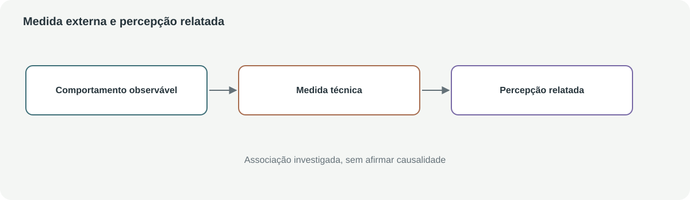
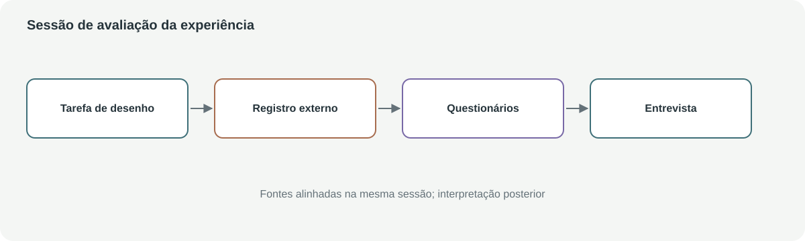
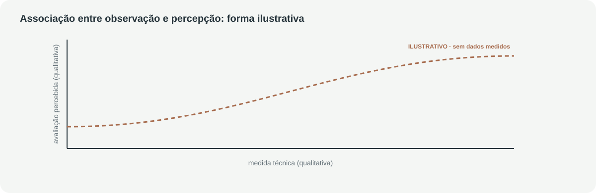

# Qualidade percebida e continuidade na interação com desenho assistido por câmera

## Resumo

Um sistema de desenho assistido por câmera pode produzir uma resposta visualmente contínua em algumas situações e ainda assim não corresponder à experiência de quem desenha. Medidas técnicas e avaliações subjetivas respondem a perguntas diferentes; uma não substitui a outra. Este artigo organiza quatro dimensões da experiência: continuidade, previsibilidade, recuperação e controle percebido. Para cada dimensão, propõe uma medida externa e um item de questionário que poderá ser refinado com participantes. O protocolo combina uma tarefa de desenho, registros observáveis, questionário de experiência, medidas de usabilidade e carga de trabalho e entrevista na mesma sessão. A análise descritiva e associativa investigará se padrões técnicos acompanham percepções relatadas, sem atribuir causalidade ou inferir mecanismos internos. A contribuição inclui um quadro de medidas, uma sequência de coleta e limites de interpretação. Como não há dados de participantes, o artigo não relata escores, associações ou efeitos. A proposta precisa de revisão ética, avaliação dos itens e coleta em contextos definidos antes de sustentar conclusões sobre experiência de uso.

**Palavras-chave:** qualidade de experiência; continuidade; usabilidade; desenho; interação

## Abstract

A camera-assisted drawing system may produce a visually continuous response in some situations and still fail to match the experience of the person drawing. Technical measures and subjective ratings answer different questions; neither replaces the other. This article organizes four experience dimensions: continuity, predictability, recovery, and perceived control. For each dimension, it proposes an external measure and a questionnaire item to be refined with participants. The protocol combines a drawing task, observable records, an experience questionnaire, usability and workload measures, and an interview in the same session. Descriptive and associative analyses will examine whether technical patterns accompany reported perceptions, without assigning causality or inferring internal mechanisms. The contribution includes a measurement framework, a collection sequence, and limits on interpretation. Since no participant data are available, this article reports no scores, associations, or effects. The proposal requires ethics review, item evaluation, and data collection in defined contexts before it can support conclusions about user experience.

**Keywords:** quality of experience; continuity; usability; drawing; interaction

## 1. Introdução

Uma atividade de desenho assistida por câmera reúne ações físicas, materiais, observação visual e interpretação do resultado. A pessoa pode perceber continuidade quando o desenho permanece coerente durante a atividade. Também pode notar atraso, oscilação, perda temporária, recuperação demorada ou mudanças inesperadas. Essas percepções são parte da experiência, mas não podem ser deduzidas diretamente de uma única medida técnica. Um registro de resposta regular pode coexistir com uma interação que parece difícil; uma interrupção observada pode ser breve e não afetar o objetivo da pessoa.

Qualidade de experiência, ou QoE, descreve a avaliação que uma pessoa faz de um serviço ou interação sob condições de uso. A avaliação combina contexto, expectativas, tarefa e percepção. Medidas externas podem caracterizar aspectos observáveis do comportamento. Questionários e entrevistas registram a experiência relatada. A literatura de QoE e interação humano-computador propõe relacionar essas fontes, mas ressalta que uma métrica objetiva não representa, por si, satisfação, confiança ou continuidade percebida. Esse desafio ganha relevância em atividades criativas, nas quais o ritmo de ação e a intenção da pessoa podem mudar durante uma mesma sessão.

Este artigo pergunta: **como medidas técnicas observáveis durante uma tarefa de desenho se relacionam com a continuidade, previsibilidade, recuperação e controle percebidos pelas pessoas participantes?** A pergunta é associativa. Não afirma que determinada medida cause uma percepção ou que uma resposta subjetiva revele qual condição técnica a produziu. Tampouco assume que participantes compartilhem a mesma noção de continuidade ou controle. Os itens propostos devem ser examinados em linguagem acessível e refinados antes de qualquer coleta confirmatória.

A proposta delimita quatro dimensões relacionadas, mas distintas. Continuidade descreve se a atividade parece seguir sem rupturas não desejadas. Previsibilidade diz respeito à possibilidade de antecipar a resposta visível. Recuperação aborda a percepção depois de uma interrupção ou mudança. Controle percebido descreve se a pessoa considera que pode prosseguir, pausar ou ajustar sua ação de modo compreensível. Consistência e confiança aparecem como conceitos auxiliares que podem contextualizar as quatro dimensões, sem ampliar o modelo principal para além da literatura e das medidas definidas.

A contribuição é metodológica. Primeiro, relaciona cada dimensão a uma medida externa e a um item de questionário para deixar explícita a diferença entre observação e relato. Segundo, define um protocolo com tarefa, registro técnico e questionários na mesma sessão, complementado por entrevista. Terceiro, estabelece uma análise exploratória por associação e modelo simples, com relato de incerteza e limites, sem linguagem causal. Não há dados próprios neste artigo; por isso, os itens não são apresentados como uma escala validada e nenhuma relação esperada é relatada como resultado.

A proposta avalia apenas eventos visíveis durante a tarefa e compara esses registros com respostas dadas pela pessoa. As medidas são formuladas como propriedades observáveis, por exemplo a duração de uma interrupção ou a frequência com que a resposta visível deixa de acompanhar a atividade. A definição operacional final precisa ser estabelecida antes do estudo e aplicada do mesmo modo a todas as sessões comparáveis.

O uso de questionários padronizados requer cuidado. A System Usability Scale (SUS) fornece uma visão geral de usabilidade percebida, enquanto a NASA Task Load Index (NASA-TLX) caracteriza carga de trabalho relatada. Esses instrumentos não substituem itens específicos sobre continuidade e recuperação. Os itens deste artigo são propostas de pesquisa, não uma escala pronta. Sua compreensão, relevância e adequação precisam ser avaliadas com pessoas que representam os contextos de uso pretendidos. Uma adaptação de idioma ou modo de resposta deve ser documentada para não presumir equivalência com aplicações anteriores.

A seção 2 revisa QoE, usabilidade, carga de trabalho e percepção de continuidade em interação. A seção 3 define as dimensões e apresenta a correspondência entre medidas e perguntas. A seção 4 detalha o protocolo, o recrutamento, a coleta e a análise. A seção 5 delimita o que poderá ser reportado depois da coleta. A seção 6 interpreta possibilidades sem antecipar resultados. A seção 7 discute ameaças à validade e limites de generalização. A seção 8 resume a evidência ainda necessária. O próximo estágio é revisar os itens com participantes e obter aprovação ética antes de iniciar o recrutamento.

## 2. Trabalhos relacionados

### 2.1 Qualidade de experiência e percepção

Qualidade de experiência (QoE) trata da avaliação subjetiva de uma interação ou serviço sob condições definidas. Trabalhos de padronização distinguem a percepção da pessoa das medidas técnicas que caracterizam a sessão. A avaliação depende de tarefa, ambiente, expectativa e características individuais. Esse quadro é importante porque uma medida objetiva pode ajudar a explicar uma percepção, mas não a determina de forma universal. Pesquisas em telecomunicações e mídia interativa propõem métodos de avaliação que combinam descrição do estímulo, condições de apresentação e julgamento subjetivo [1–4].

Em interação humano-computador, a experiência também inclui dimensões que vão além do sucesso instrumental da tarefa. Usabilidade, satisfação, engajamento, facilidade percebida e confiança podem estar relacionadas, porém não são conceitos intercambiáveis [5, 6, 18–23]. Uma pessoa pode completar uma ação e ainda relatar desconforto. Outra pode aceitar uma interrupção quando ela é previsível e fácil de recuperar. O estudo separa conclusão da tarefa, comportamento observado e avaliação relatada para não condensar essas evidências em um único escore.

Uma métrica de QoE precisa declarar unidade de análise e momento de avaliação. Uma avaliação após cada tarefa pode captar uma impressão geral, mas depender de memória. Uma pergunta imediatamente após um evento pode se aproximar da percepção local, mas interromper a atividade. Uma entrevista final oferece contexto e detalhes não previstos, porém pode reconstituir episódios de modo impreciso. O protocolo proposto combina medidas agregadas por sessão e perguntas após blocos curtos, com entrevista ao final para interpretar divergências.

A relação entre medida e percepção pode ser linear, não linear, dependente do contexto ou inexistente na amostra [7–12]. Diferenças individuais podem refletir expectativa, familiaridade, estratégia, propósito ou condição da sessão. Por isso, o protocolo registra contexto mínimo relevante e examina heterogeneidade sem atribuí-la a características pessoais como causa. A apresentação dos resultados precisa incluir dispersão e incerteza, evitando tratar uma média como experiência típica de todas as pessoas.

### 2.2 Usabilidade e carga de trabalho

Usabilidade descreve se pessoas específicas conseguem atingir objetivos com eficácia, eficiência e satisfação em um contexto definido. A definição contextual impede que uma propriedade seja atribuída abstratamente a um sistema sem explicitar tarefa, público e ambiente [5]. A SUS foi proposta como questionário breve de avaliação global e recebeu estudos sobre uso, interpretação e propriedades de medida [24–26]. Sua pontuação não identifica, sozinha, qual aspecto produziu uma avaliação alta ou baixa; por isso, deve ser acompanhada por medidas específicas e comentários.

A NASA-TLX foi desenvolvida para avaliar carga de trabalho percebida em dimensões distintas [27, 28]. A escala pode ajudar a caracterizar a exigência subjetiva da tarefa, mas não mede continuidade nem qualidade artística. Estudos de carga subjetiva alertam que instrumentos diferentes podem responder a perguntas distintas e que a escolha do método precisa seguir o objetivo [29]. Neste artigo, a NASA-TLX é contexto adicional: uma experiência percebida como descontínua pode ser acompanhada por maior esforço relatado, mas essa relação é hipótese a testar, não evidência já obtida.

Uma interpretação responsável documenta versão, idioma, modo de administração, momento e adaptações de cada instrumento. A SUS deve ser apresentada segundo o procedimento documentado e com qualquer alteração assinalada. A NASA-TLX pode ser administrada de formas distintas; a opção precisa ser definida antes da coleta. Se uma pessoa preferir responder oralmente ou usar apoio de leitura, o protocolo deve registrar a adaptação e preservar voluntariedade. A comparabilidade com dados publicados não deve ser presumida quando o instrumento ou a forma de resposta mudou.

Questionários globais não capturam vocabulário ou prioridades de cada pessoa. Uma entrevista pode revelar que “continuidade” significa manter o traço visível, não interromper uma conversa, ou conseguir retomar depois de uma pausa. Itens específicos devem ser claros sem impor uma definição rígida. Recomenda-se verificar entendimento por entrevistas cognitivas ou revisão participativa antes de tratá-los como medidas confirmatórias. A proposta também evita transformar respostas individuais em diagnóstico ou julgamento de competência [30].

### 2.3 Continuidade e fluxo em atividades criativas

Estudos de resposta temporal em interfaces distinguem o intervalo entre ação e retorno observável, a regularidade da resposta e a interrupção de uma atividade. Pesquisa de interação com tinta digital investiga como a resposta visual participa da percepção de escrita e desenho [16–19]. Esses contextos são próximos por envolverem movimento e traço, mas suas configurações de tela, caneta e tarefa diferem de uma atividade em papel acompanhada por câmera. O artigo usa essa literatura para formular dimensões mensuráveis e não para assumir limites universais de aceitabilidade.

Trabalhos sobre experiência em sistemas interativos discutem envolvimento, contexto, interação e avaliação como dimensões relacionadas, sem reduzir experiência a desempenho técnico [18–23]. Este artigo não adota “fluxo” como variável nem o usa como sinônimo de continuidade técnica ou satisfação. Uma atividade pode parecer contínua sem que se afirme um estado psicológico específico; também pode conter uma pausa desejada sem prejudicar a experiência. As entrevistas ajudam a distinguir interrupção indesejada, descanso, mudança planejada e evento externo.

Continuidade percebida depende de expectativa e tarefa. Uma espera pode ser aceitável se a pessoa entende que algo está acontecendo; uma resposta rápida pode parecer imprevisível se muda sem relação aparente com sua ação. Recuperação pode importar mais do que ausência absoluta de interrupção, especialmente quando a pessoa consegue retomar com compreensão do estado da tarefa. A literatura sobre experiência temporal, resposta percebida e modelos de qualidade de serviço orienta o vocabulário, mas não fornece uma regra direta para uma tarefa de desenho em papel [2, 3, 16–19].

A lacuna que orienta este artigo é a falta de um quadro específico que ligue medidas externas observáveis durante desenho a itens que perguntam sobre continuidade, previsibilidade, recuperação e controle. Medidas técnicas são necessárias para descrever o que ocorreu, mas não revelam o significado da ocorrência. Questionários e entrevistas são necessários para captar a interpretação, mas não substituem a descrição da atividade. O protocolo proposto combina as fontes na mesma sessão e mantém a análise associativa.

## 3. Enquadramento do problema

O quadro distingue medidas observáveis de avaliações relatadas. Uma medida técnica descreve um evento visível e sua ocorrência sob a tarefa definida. Um item de questionário pergunta como a pessoa interpretou ou avaliou a interação. O par não afirma que os dois conceitos sejam equivalentes. Ele cria uma pergunta analítica que pode ser explorada por sessão e por bloco de atividade.

**Continuidade** é a percepção de que a atividade acompanhou o desenho sem interrupções que a pessoa considerasse indesejadas. Uma medida externa pode registrar períodos em que a resposta visível deixa de acompanhar a ação observada, além da duração e frequência dessas ocorrências. Uma pausa planejada pela pessoa não deve ser classificada como falha de continuidade. O contexto distingue pausa intencional, intervalo de descanso e interrupção não solicitada.

**Previsibilidade** descreve se a pessoa consegue antecipar, com base nas ações realizadas, quando e como uma resposta visível ocorrerá. A medida externa proposta caracteriza a variação temporal entre ações comparáveis e as respostas visíveis correspondentes. O item pergunta pela previsibilidade percebida, sem sugerir que uma distribuição estável necessariamente pareça previsível. A expectativa da pessoa e sua familiaridade com a tarefa podem alterar a interpretação.

**Recuperação** descreve a percepção depois de uma interrupção ou mudança observável. A medida externa caracteriza o intervalo entre o fim de uma ocorrência visível e a retomada de uma resposta que permita prosseguir. O protocolo define previamente quais eventos contam como início e fim, sem usar informações internas. O item de questionário pergunta se a recuperação foi suficiente para retomar a atividade, em vez de impor uma noção universal de rapidez.

**Controle percebido** indica se a pessoa sente que consegue escolher quando continuar, pausar, repetir ou alterar sua ação. A medida externa registra ações voluntárias de pausa e retomada, pedidos de auxílio e episódios em que a pessoa tenta recuperar a atividade. Esses registros não provam que ela teve controle; a percepção precisa ser perguntada diretamente. Uma escolha de não continuar pode ser uma decisão autônoma, não uma falha do participante.

Consistência, interrupção, confiança e esforço complementam as quatro dimensões centrais. Consistência pode ser caracterizada pela variação da resposta visível em ações comparáveis. Interrupção descreve eventos que quebram a tarefa e não foram planejados pela pessoa. Confiança para prosseguir é uma avaliação de intenção, não uma medida técnica. Esforço é subjetivo e pode ser contextualizado pela NASA-TLX, sem inferir capacidade. Essas dimensões auxiliares ajudam a interpretar os pares centrais, mas devem ser analisadas separadamente.

Os itens da Tabela 1 são formulações iniciais, não perguntas validadas. Sua linguagem deve ser testada por revisão participativa e entrevistas cognitivas antes de uso formal. Cada item usa uma escala de resposta definida na versão final do protocolo e uma opção para indicar que a pessoa não observou ou não compreendeu a situação. Os itens específicos podem ser apresentados depois de cada bloco para reduzir dependência de memória. Alterar formulações durante a coleta exige documentar quais respostas permanecem comparáveis.

**Tabela 1.** Matriz conceitual que liga dimensões percebidas a medidas externas e itens de questionário, para manter separadas observação técnica e interpretação da experiência, com finalidade operacional em estudos futuros.

| Dimensão | Medida técnica observável | Item de questionário proposto |
|---|---|---|
| Continuidade | Duração e frequência de intervalos observáveis sem resposta visível durante a ação. | “O desenho pareceu seguir sem interrupções indesejadas.” |
| Continuidade da tarefa | Número de retomadas após interrupção não planejada, com contexto anotado. | “Consegui continuar minha atividade sem perder o fio do que estava fazendo.” |
| Previsibilidade | Variação temporal entre ações comparáveis e respostas visíveis. | “Eu conseguia antecipar quando a resposta apareceria.” |
| Recuperação | Intervalo observável entre o fim da interrupção e a resposta visível seguinte. | “Depois de uma pausa, a resposta voltou a tempo de eu continuar.” |
| Controle percebido | Ações voluntárias de pausa e retomada, e pedidos de ajuda registrados. | “Senti que podia decidir quando prosseguir ou fazer uma pausa.” |
| Consistência | Variação da resposta observável em ações comparáveis ao longo da sessão. | “A resposta pareceu consistente durante a atividade.” |
| Interrupção | Ocorrências observáveis que interrompem uma ação não pausada pela pessoa. | “Houve momentos em que a interação interrompeu o que eu pretendia fazer.” |
| Confiança para prosseguir | Escolha declarada de continuar, repetir, pausar ou encerrar após cada bloco. | “Eu me senti seguro para continuar depois das situações que ocorreram.” |

A Figura 1 resume o vínculo analítico entre comportamento observável, medida e percepção. As setas representam a pergunta de pesquisa, não uma cadeia causal ou mecanismo do sistema.

**Figura 1.** Modelo conceitual entre medida externa e percepção relatada; a associação será examinada sem assumir causalidade ou mecanismo interno; elaboração própria para separar evento observado e interpretação.

## 4. Protocolo de avaliação proposto

O protocolo combina observação técnica externa e medidas subjetivas durante a mesma sessão. A pergunta, tarefa, condições de captura e regras de anotação são definidas antes do recrutamento. O sistema é tratado como caixa-preta: o estudo não registra etapas internas, configurações privadas ou estados não observáveis. O comportamento de interesse é a resposta visível que pode ser associada temporalmente à ação da pessoa. Câmera de pesquisa ou gravação da tela é usada apenas quando necessária, aprovada eticamente e autorizada pela pessoa participante.

O estudo deve obter aprovação do comitê de ética aplicável antes do contato de recrutamento. Materiais de convite, consentimento, tarefa, questionário e entrevista precisam estar disponíveis em formatos acessíveis. O consentimento apresenta objetivos, procedimentos, riscos, dados coletados, acesso, retenção, possibilidade de gravação e forma de retirada. A participação é voluntária. A pessoa pode recusar a gravação, pausar ou encerrar sem penalidade. O procedimento descreve uma alternativa para registrar a sessão quando houver recusa, se essa alternativa preservar o objetivo metodológico.

O recrutamento busca pessoas com diferentes experiências de desenho, familiaridade com ferramentas digitais e necessidades de acesso relevantes ao estudo. A equipe justifica critérios de inclusão e exclusão, descreve canais de recrutamento e evita definir deficiência como diagnóstico obrigatório quando a pergunta não o exige. A composição da amostra não é inventada nesta proposta. A viabilidade e diversidade possível são avaliadas antes da coleta e documentadas no relato. Características sensíveis só são perguntadas quando necessárias, com justificativa e opção de não responder.

Antes da tarefa, a equipe explica o procedimento, oferece oportunidade de experimentar materiais e pergunta qual forma de comunicação e resposta é preferida. A pessoa escolhe uma atividade compatível com o protocolo, como desenhar um elemento simples ou continuar um desenho próprio. A tarefa não depende de habilidade artística prévia. Se o estudo exigir uma instrução comum, ela deve ser testada previamente para garantir que não favoreça um repertório cultural específico. A pessoa pode adaptar sua estratégia, com registro do contexto.

A coleta ocorre em blocos de atividade definidos de modo que medidas e respostas possam ser relacionadas sem interromper excessivamente o desenho. Para cada bloco, um observador externo marca ação, resposta visível, intervalos, interrupções, pausas voluntárias, retomadas e pedidos de ajuda. Os tempos são extraídos de um registro sincronizado e descritos na unidade e na precisão efetivamente disponíveis, sem relatar precisão maior do que a coleta suporta. Anotações de contexto indicam tarefa, material, posição escolhida e eventos externos que afetaram a sessão.

Após cada bloco, a pessoa responde aos itens de continuidade, previsibilidade, recuperação e controle que correspondam ao que acabou de acontecer. A formulação usa primeira pessoa e linguagem concreta. A equipe não lê uma interpretação sugerida como se fosse resposta esperada. Se o bloco não incluir determinada ocorrência, o participante pode indicar que não se aplica. Essa resposta não é convertida em avaliação positiva nem negativa. A ordem de itens e o tempo da aplicação são definidos antes da coleta e mantidos consistentes.

Ao final, a SUS oferece uma avaliação geral de usabilidade e a NASA-TLX contextualiza carga de trabalho percebida [24, 27, 28]. Esses instrumentos são separados dos itens específicos. A SUS não é usada como substituta das dimensões do quadro; a NASA-TLX não é interpretada como medida de desempenho. Uma entrevista semiestruturada explora quais eventos foram notados, o que pareceu previsível, o que permitiu retomar a tarefa e como a pessoa definiu controle. As perguntas abertas ajudam a identificar significado divergente dos termos propostos.

Os observadores recebem treinamento com exemplos de codificação que não incluam resultados esperados. Se duas pessoas codificarem registros, o acordo e os desacordos serão avaliados e discutidos. A equipe conserva regras de anotação, exemplos de casos ambíguos e decisões de adjudicação. Não se presume que consenso entre codificadores elimine subjetividade. A codificação deve captar eventos observáveis, enquanto a interpretação da pessoa permanece uma fonte separada.

A análise começa com descrições por participante, tarefa e bloco, incluindo distribuição, valores ausentes e contexto. Eventos observáveis e respostas são alinhados pela marcação temporal externa, com a incerteza de sincronização declarada. Antes de examinar associações, a equipe define qual dimensão é principal e quais comparações são exploratórias. A escolha reduz a tentação de selecionar depois apenas a relação mais favorável. O plano também registra como serão tratadas respostas “não se aplica” e blocos em que a situação perguntada não ocorreu.

Para associação entre escalas ordinais ou distribuições sem adequação a pressupostos paramétricos, a equipe pode optar por correlação de postos. Uma correlação de Pearson só será considerada quando as variáveis e a forma da relação justificarem esse uso. A decisão é documentada antes da análise final. As estimativas são acompanhadas por intervalos de incerteza e interpretação substantiva, não apenas por significância estatística. Quando observações de diferentes blocos vêm da mesma pessoa, a dependência precisa ser reconhecida. Pode-se resumir por participante ou usar um modelo que represente agrupamento, se o desenho e a quantidade de dados permitirem.

O modelo simples relaciona uma dimensão percebida a uma medida externa escolhida previamente. Covariáveis de contexto devem ser poucas e justificadas pela pergunta, como familiaridade autorrelatada com a tarefa ou modalidade de participação. O modelo não procura explicar a experiência inteira, nem atribuir causalidade. Se os dados forem insuficientes para estimativas estáveis, o relato se limita a descrições e intervalos de incerteza. A equipe não inventa amostra ou efeito esperado; a viabilidade e o planejamento de tamanho são definidos antes do recrutamento, com base na precisão pretendida e na disponibilidade de participantes.

Antes da coleta principal, entrevistas cognitivas ou revisão participativa examinam se as perguntas são compreendidas como pretendido e se as dimensões fazem sentido para diferentes pessoas. Um estudo piloto verifica o fluxo de sessão e as regras de anotação. Alterações resultantes são documentadas; dados do piloto só são combinados com a coleta principal quando a decisão for justificada e compatível com o protocolo aprovado. Esse processo reduz ambiguidades sem apresentar itens preliminares como medida validada.

As fontes e seus limites estão na Tabela 2. A combinação das fontes permite comparar eventos observados e experiência relatada sem fundi-los numa pontuação única. A Figura 2 mostra a sequência externa da sessão. Ela descreve somente ações da pesquisa, sem representar o processamento interno do sistema.

**Tabela 2.** Instrumentos para registrar comportamento técnico observável, qualidade percebida, usabilidade e carga de trabalho, descrevendo objetivo, momento e limite de interpretação em contexto e com respostas acessíveis.

| Fonte | Medida ou instrumento | Momento | Limite |
|---|---|---|---|
| Observação externa | Intervalos, interrupções, retomadas e ações observáveis. | Durante cada bloco de desenho. | Depende de anotação consistente e contexto registrado. |
| Itens de dimensão | Continuidade, previsibilidade, recuperação e controle relatados. | Após o bloco correspondente. | Formulações propostas; precisam de revisão participativa. |
| SUS | Avaliação global de usabilidade percebida. | Após a tarefa completa. | Não explica isoladamente a origem da avaliação. |
| NASA-TLX | Carga de trabalho percebida durante a tarefa. | Após a tarefa completa. | Não mede continuidade nem desempenho técnico. |
| Entrevista | Estratégias, expectativas, interpretações e preferências. | Após questionários. | Interpretação qualitativa requer transparência e reflexividade. |

**Figura 2.** Desenho externo da sessão que combina atividade, registro observável e percepção relatada, sem representar etapas internas do sistema; elaboração própria para mostrar fontes de evidência e momento de coleta.

A Figura 3 apresenta uma forma qualitativa possível para a relação, sem sugerir direção ou intensidade observadas. Os dados poderão mostrar outro padrão ou não indicar associação.

**Figura 3.** Curva conceitual da associação entre observação técnica e avaliação percebida; forma esperada, não é resultado; eixos qualitativos sem valores medidos; elaboração própria para evitar sugerir estimativas existentes.

## 5. Estrutura dos resultados

Não há dados coletados para este artigo. Os quadros abaixo indicam apenas a estrutura a preencher após aprovação ética, revisão dos itens, recrutamento e execução do protocolo. Nenhum escore, associação ou efeito é antecipado. A Figura 3 também é apenas uma forma de apresentação possível; sua curva não expressa resultado, tendência observada ou expectativa quantitativa.

| Evidência futura | Conteúdo a reportar |
|---|---|
| Medidas externas | [PENDENTE-DADOS] Definições, condições, eventos observados, dados ausentes e incerteza. |
| Itens de experiência | [PENDENTE-DADOS] Respostas por dimensão, versão aplicada e forma de administração. |
| Instrumentos gerais | [PENDENTE-DADOS] SUS, NASA-TLX e limitações de comparabilidade. |
| Associação | [PENDENTE-DADOS] Estimativas, incerteza, método escolhido e interpretação não causal. |
| Entrevistas | [PENDENTE-DADOS] Temas, contexto e exemplos anonimizados de divergência ou concordância. |

O relatório deve identificar a unidade de análise e se cada observação corresponde a uma ação, bloco ou sessão completa. Deve também descrever o número de respostas válidas quando a coleta existir, sem ocultar perdas ou itens não aplicáveis. Se um participante não observar determinado evento, essa resposta será tratada segundo uma regra definida antes da análise, não convertida automaticamente em valor mínimo ou máximo. A combinação dos instrumentos será apresentada como comparação entre fontes, não como uma escala única de experiência.

Os resultados qualitativos podem explicar por que a pessoa considerou uma resposta previsível, lenta, insuficiente ou aceitável. Exemplos serão anonimizados e selecionados de modo a não identificar participante ou situação privada. Interpretações serão relacionadas à pergunta e à tarefa, com espaço para casos que não se ajustem ao padrão principal. Até a coleta, cada campo permanece pendente e não sustenta uma afirmação sobre o sistema.

## 6. Discussão

Uma associação entre um intervalo observável e a avaliação de continuidade seria compatível com a hipótese de que aspectos temporais acompanham a experiência relatada. Ainda assim, correlação não indicaria que o intervalo causou a avaliação. Expectativas, intenção, familiaridade, material, ambiente e estratégias escolhidas poderiam influenciar ambas as medidas. A análise deveria relatar o padrão como relação observada na amostra e indicar outras explicações plausíveis.

Uma associação fraca ou ausente também seria informativa, mas não provaria que a dimensão técnica é irrelevante. A medida externa pode não representar o evento que a pessoa percebeu; o item pode não captar seu vocabulário; a tarefa pode não ter gerado variação suficiente; ou o contexto pode ter moderado a experiência. Entrevistas e registros contextuais ajudariam a avaliar essas possibilidades. O artigo evita concluir que pessoas não se importam com um aspecto só porque uma relação não apareceu no conjunto observado.

Se os questionários indicarem continuidade e as entrevistas descreverem interrupções, ambas as fontes devem permanecer visíveis. A divergência pode refletir uma impressão global positiva apesar de episódios específicos, uma interpretação distinta de “interrupção” ou uma diferença de memória entre os momentos da coleta. A entrevista pode ainda apontar que a pessoa pausou de propósito. A unidade temporal e a definição das perguntas orientam a leitura. Não se corrige uma resposta para fazê-la coincidir com a anotação técnica.

Uma resposta tecnicamente consistente pode ser percebida como imprevisível quando a pessoa não consegue antecipar o momento ou significado da atualização. Em sentido inverso, variação externa pode ser tolerada quando o resultado é compreensível e a tarefa permite recuperação. Esses cenários justificam examinar previsibilidade e recuperação separadamente. A literatura de qualidade de experiência diferencia medidas objetivas, distribuição de avaliações e aspectos contextuais [7–12]. O estudo proposto deve testar como essas distinções se apresentam nesta atividade.

O controle percebido não equivale a quantidade de ações voluntárias. Uma pessoa pode escolher poucas pausas porque a tarefa flui como deseja, ou porque não encontrou uma forma de intervir. Por isso, ação observável e resposta subjetiva são complementares. Perguntar como participantes entendem controle e o que gostariam de poder fazer impede que o pesquisador imponha uma interpretação baseada apenas em eventos registrados. Essa abordagem é compatível com estudos de experiência que reconhecem contexto, expectativas e interação como dimensões centrais [18–23].

A escolha de medidas temporais deve permanecer vinculada a uma tarefa e a um procedimento de anotação. A literatura de interação por toque e tinta digital investiga latência percebida em configurações específicas [13–17], mas seus valores não podem ser transferidos diretamente para desenho em papel acompanhado por câmera. A proposta não define limite universal de aceitabilidade. Ela propõe relacionar observações da sessão a avaliações da mesma pessoa e discutir como diferenças de tarefa e contexto limitam a comparação.

A SUS e a NASA-TLX oferecem informação geral útil, mas não respondem às perguntas centrais deste trabalho [24–30]. Um resultado geral favorável pode coexistir com baixa avaliação de recuperação. Um relato de esforço elevado pode decorrer de fatores alheios à continuidade. A análise deve preservar escopos e unidades dos instrumentos. Se forem apresentadas correlações entre os questionários gerais e os itens específicos, elas serão exploratórias e não substituirão interpretação qualitativa.

Uma contribuição prática possível é orientar a revisão de tarefas e critérios de qualidade com base em eventos que as pessoas realmente consideram relevantes. Essa contribuição exige incluir pessoas diversas desde o refinamento dos itens, não apenas ao final do processo. Itens podem precisar de revisão quando participantes interpretam uma palavra de forma inesperada. A equipe registra essa decisão, examina se as respostas anteriores permanecem comparáveis e delimita o alcance das conclusões.

Por fim, a associação proposta não permite classificar sistemas, participantes ou usos como bons ou ruins sem um padrão justificado. Ela oferece um caminho para observar relações, identificar discrepâncias e formular novos estudos. Reprodutibilidade depende de definições de evento, sincronização, tarefas, itens e análise descritas com clareza. A interpretação deve reconhecer resultados incertos e heterogêneos como parte da experiência, em vez de resumi-los em um único indicador.

## 7. Limitações e ameaças à validade

**Validade de construção.** Continuidade, previsibilidade, recuperação e controle percebido são dimensões propostas e não constituem uma escala validada. Itens preliminares podem não cobrir a experiência que participantes consideram relevante. Medidas externas também podem representar apenas eventos visíveis escolhidos pelo protocolo. Revisão participativa e entrevistas cognitivas reduzem ambiguidades, mas não provam que todos os significados estejam cobertos.

**Validade interna.** Medidas e respostas na mesma sessão facilitam o pareamento, mas observação e relato podem influenciar-se. Questionários repetidos podem interromper a atividade; lembrança do bloco pode ser incompleta; presença de pesquisador ou gravação pode alterar comportamento. A familiaridade com desenho, material, ambiente e tarefa pode explicar parte da relação. O desenho observacional não controla todas as causas possíveis e não permite conclusão causal.

**Validade externa.** Uma amostra de conveniência e um conjunto limitado de tarefas não representam todas as pessoas, materiais ou contextos. Desenho livre, exercício guiado e tarefa colaborativa podem produzir experiências diferentes. A disponibilidade de equipamentos e o ambiente também variam. O relato deve descrever contexto com o nível necessário para interpretação, sem prometer generalização populacional nem expor dados identificáveis.

**Validade dos instrumentos e dados.** SUS e NASA-TLX têm propósitos definidos, mas seu idioma, formato e administração precisam ser adequados à amostra. Adaptações podem reduzir comparabilidade. Itens propostos podem apresentar viés de resposta ou ambiguidade. Anotadores podem discordar sobre começo e fim de um evento observável. Regras predefinidas, treinamento, auditoria de codificação e documentação de dados ausentes ajudam a tornar essas incertezas visíveis, mas não as eliminam.

**Análise estatística.** Correlações podem ser influenciadas por observações dependentes da mesma pessoa, distribuição limitada ou medidas ordinais. O modelo simples deve evitar excesso de preditores e ser interpretado de forma exploratória quando a amostra não sustentar estimativas estáveis. A equipe define a estratégia antes de examinar relações, apresenta incerteza e evita selecionar apenas associações favoráveis. Resultados nulos ou imprecisos não serão descritos como prova de ausência de relação.

**Ética e privacidade.** Registros temporais, áudio, vídeo e entrevista podem conter informação identificável. O protocolo coleta somente o necessário, separa consentimentos quando apropriado e restringe acesso. A pessoa pode recusar gravação e ainda participar quando o desenho permitir. Aprovação ética deve anteceder qualquer recrutamento, e o material final deve explicar retenção e descarte segundo a política aplicável.

## 8. Conclusão

Este artigo propõe relacionar medidas técnicas observáveis às percepções de continuidade, previsibilidade, recuperação e controle durante atividades de desenho assistidas por câmera. A matriz explicita pares entre eventos e itens de questionário; o protocolo combina observação externa, instrumentos gerais e entrevista na mesma sessão. A análise é associativa e preserva a diferença entre o que foi observado e o que foi relatado.

Não há dados para afirmar que as dimensões se relacionam, nem que uma condição produza determinada experiência. Antes da coleta, os itens precisam ser revistos com participantes, o protocolo deve receber aprovação ética e a tarefa deve ser testada em contextos definidos. A análise futura deve relatar incerteza, diferenças individuais e resultados divergentes sem causalidade. Só então será possível avaliar se o quadro explica aspectos relevantes da experiência nesta atividade.

O refinamento participativo deve verificar se as palavras dos itens correspondem às situações que as pessoas observam e valorizam. Um piloto deve confirmar que o registro externo e as perguntas cabem no fluxo da tarefa sem impor pausas excessivas. O estudo principal deve separar medidas por fonte, preservar casos divergentes e limitar conclusões à amostra e às condições observadas. A proposta oferece uma estrutura para realizar essa avaliação, não uma conclusão sobre a qualidade atual da experiência.

## Declarações

- Uso de IA: texto redigido com apoio de IA generativa, com revisão e responsabilidade dos autores; referências conferidas por DOI ou página primária.
- Dados: nenhum dado de participantes foi coletado para esta proposta.
- Código: não há código de análise ou coleta associado a resultados neste artigo.
- Conflito de interesses: os autores devem declarar conflitos relacionados ao estudo antes da submissão.
- Ética: o protocolo será submetido ao comitê de ética em pesquisa aplicável antes do recrutamento e da coleta com participantes.
- Contribuição dos autores: a definir pelos autores de acordo com suas contribuições efetivas.

## Referências

[1] ITU-T. P.10/G.100: Vocabulary for performance, quality of service and quality of experience. Edition 2017, Amendment 2, 2024. International Telecommunication Union. https://www.itu.int/rec/T-REC-P.10/en
[2] ITU-T. P.800: Methods for subjective determination of transmission quality. Recommendation, 1996. International Telecommunication Union. https://www.itu.int/rec/t-rec-p.800-199608-i
[3] ITU-T. P.812: Principles of subjective test methods for interactive virtual reality applications. Recommendation, 2024. International Telecommunication Union. https://www.itu.int/epublications/publication/itu-t-p-812-2024-05-principles-of-subjective-test-methods-for-interactive-virtual-reality-vr-applications
[4] ITU-T. P.910: Subjective video quality assessment methods for multimedia applications. 2023 edition. International Telecommunication Union. https://www.itu.int/rec/dologin_pub.asp?id=T-REC-P.910-202310-I%21%21PDF-E&lang=e&type=items
[5] ISO. ISO 9241-11:2018 — Ergonomics of human-system interaction: Usability: Definitions and concepts. International Organization for Standardization, 2018. https://www.iso.org/standard/63500.html
[6] ISO. ISO 9241-210:2019 — Ergonomics of human-system interaction: Human-centred design for interactive systems. International Organization for Standardization, 2019. https://www.iso.org/standard/77520.html
[7] Brooks, P. User measures of quality of experience: why being objective and quantitative is important. IEEE Network, 24(2), 2010. https://doi.org/10.1109/MNET.2010.5430138
[8] Hoßfeld, T.; Heegaard, P. E.; Varela, M.; Möller, S. QoE beyond the MOS: an in-depth look at QoE via better metrics and their relation to MOS. Quality and User Experience, 1, 2016. https://doi.org/10.1007/s41233-016-0002-1
[9] Seufert, M. Statistical methods and models based on quality of experience distributions. Quality and User Experience, 2021. https://doi.org/10.1007/s41233-020-00044-z
[10] Baraković, S.; Skorin-Kapov, L. Survey and Challenges of QoE Management Issues in Wireless Networks. Journal of Computer Networks and Communications, 2013. https://doi.org/10.1155/2013/165146
[11] Yamazaki, T. Quality of Experience (QoE) Studies: Present State and Future Prospect. IEICE Transactions on Communications, E104.B(7), 2021. https://doi.org/10.1587/transcom.2020CQI0003
[12] Möller, S.; Raake, A., editors. Quality of Experience: Advanced Concepts, Applications and Methods. Springer, 2014. https://doi.org/10.1007/978-3-319-02681-7
[13] Deber, J.; Jota, R.; Forlines, C.; Wigdor, D. How Much Faster is Fast Enough? Proceedings of the ACM Conference on Human Factors in Computing Systems, 2015. https://doi.org/10.1145/2702123.2702300
[14] Jota, R.; Ng, A.; Dietz, P.; Wigdor, D. How fast is fast enough? A study of the effects of latency in direct-touch pointing tasks. Proceedings of the ACM Conference on Human Factors in Computing Systems, 2013. https://doi.org/10.1145/2470654.2481317
[15] Ng, A.; Annett, M.; Dietz, P.; Gupta, A.; Bischof, W. F. In the blink of an eye: Investigating latency perception during stylus interaction. Proceedings of the ACM Conference on Human Factors in Computing Systems, 2014. https://doi.org/10.1145/2556288.2557037
[16] Annett, M. Digitally Inking in the 21st Century. IEEE Computer Graphics and Applications, 37(1), 2017. https://doi.org/10.1109/MCG.2017.1
[17] MacKenzie, I. S.; Ware, C. Lag as a determinant of human performance in interactive systems. Proceedings of the ACM Conference on Human Factors in Computing Systems, 1993. https://doi.org/10.1145/169059.169431
[18] Hassenzahl, M.; Tractinsky, N. User experience—a research agenda. Behaviour & Information Technology, 25(2), 2006. https://doi.org/10.1080/01449290500330331
[19] Law, E. L.-C.; Roto, V.; Hassenzahl, M.; Vermeeren, A. P. O. S.; Kort, J. Understanding, scoping and defining user experience: a survey approach. Proceedings of the ACM Conference on Human Factors in Computing Systems, 2009. https://doi.org/10.1145/1518701.1518813
[20] Law, E.; Roto, V.; Vermeeren, A. P. O. S.; Kort, J.; Hassenzahl, M. Towards a shared definition of user experience. CHI Extended Abstracts, 2008. https://doi.org/10.1145/1358628.1358693
[21] Forlizzi, J.; Battarbee, K. Understanding experience in interactive systems. Proceedings of the ACM Conference on Designing Interactive Systems, 2004. https://doi.org/10.1145/1013115.1013152
[22] Laugwitz, B.; Held, T.; Schrepp, M. Construction and Evaluation of a User Experience Questionnaire. Lecture Notes in Computer Science, 2008. https://doi.org/10.1007/978-3-540-89350-9_6
[23] Vermeeren, A. P. O. S.; Law, E.; Roto, V.; Obrist, M.; Hoonhout, J.; Väänänen-Vainio-Mattila, K. User experience evaluation methods: current state and development needs. Proceedings of NordiCHI, 2010. https://doi.org/10.1145/1868914.1868973
[24] Brooke, J. SUS: A “Quick and Dirty” Usability Scale. In Usability Evaluation in Industry, Taylor & Francis, 1996. https://www.taylorfrancis.com/chapters/edit/10.1201/9781498710411-35/sus-quick-dirty-usability-scale-john-brooke
[25] Bangor, A.; Kortum, P. T.; Miller, J. T. An Empirical Evaluation of the System Usability Scale. International Journal of Human–Computer Interaction, 24(6), 2008. https://doi.org/10.1080/10447310802205776
[26] Lewis, J. R. The System Usability Scale: Past, Present, and Future. International Journal of Human–Computer Interaction, 34(7), 2018. https://doi.org/10.1080/10447318.2018.1455307
[27] Hart, S. G.; Staveland, L. E. Development of NASA-TLX (Task Load Index): Results of Empirical and Theoretical Research. In Human Mental Workload, 1988. https://doi.org/10.1016/S0166-4115(08)62386-9
[28] Hart, S. G. NASA-Task Load Index (NASA-TLX); 20 Years Later. Proceedings of the Human Factors and Ergonomics Society Annual Meeting, 50(9), 2006. https://doi.org/10.1177/154193120605000909
[29] Rubio, S.; Díaz, E.; Martín, J.; Puente, J. M. Evaluation of Subjective Mental Workload: A Comparison of SWAT, NASA-TLX, and Workload Profile Methods. Applied Psychology, 53(1), 2004. https://doi.org/10.1111/j.1464-0597.2004.00161.x
[30] Sauro, J.; Lewis, J. R. Quantifying the User Experience: Practical Statistics for User Research. 2nd edition, Morgan Kaufmann, 2016. https://www.sciencedirect.com/book/monograph/9780128023082/quantifying-the-user-experience
